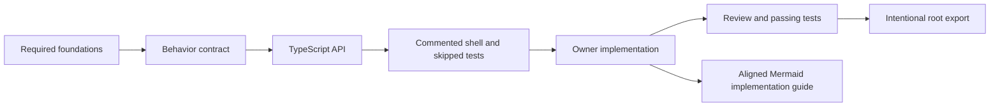

# AlgoHatch

AlgoHatch is a TypeScript-first data structures and algorithms library and practical learning
track. It develops each topic from understandable foundations into documented, tested public code.

## Current Learning Path

The JavaScript storage and complexity foundations are reviewed. The finite exercise curriculum is
research-audited and prepared for owner review. Source shells and tests remain dormant and
non-public until their topic is activated.

- [Practical foundations](docs/fundamentals.md)
- [Arrays and DynamicArray](packages/algohatch/src/data-structures/array/dynamic-array/README.md)
- [V8 runtime notes](docs/runtime/v8.md)
- [Exercise lifecycle](docs/exercises.md)
- [Comprehensive catalog](curriculum/catalog.md)
- [Roadmap](curriculum/roadmap.md)
- [Current progress](curriculum/progress.md)

No data structure is release-ready yet. `DynamicArray<T>` has a proposed contract, skipped tests,
and an intentionally incomplete internal class shell for later owner implementation.

## Topic Structure

Each data-structure topic follows the same practical sequence: purpose, behavior contract, public
API, operation diagrams, implementations, correctness rules, complexity, trade-offs, and shared
tests. The repository can therefore serve as the source material for an explanation or video
without a separate script.



## Repository

- `packages/algohatch/src/data-structures`: ADT family READMEs/contracts/shared tests, with a child
  README and source folder for every independently named implementation.
- `packages/algohatch/src/algorithms`: one source file per algorithm, family contracts, guidance,
  and colocated tests.
- `docs/fundamentals.md`: shared concepts needed by later structures and algorithms.
- `docs/runtime`: maintained runtime learning notes linked from relevant topics.
- `docs/architecture`: repository-wide decisions.
- `docs/tooling.md`: what each development tool and configuration does.
- `curriculum`: topic order and progress.
- `tools/validation`: verifies the built package boundary from a separate workspace project.

```sh
pnpm install
pnpm check
pnpm release:check
```

`pnpm release:check` performs the normal quality gate, packs the npm artifact, validates its
metadata and declarations, installs it into a temporary project, and exercises its public runtime
entry point. It never publishes the package.

Nothing is published, pushed, tagged, released, or deployed without explicit owner approval.
