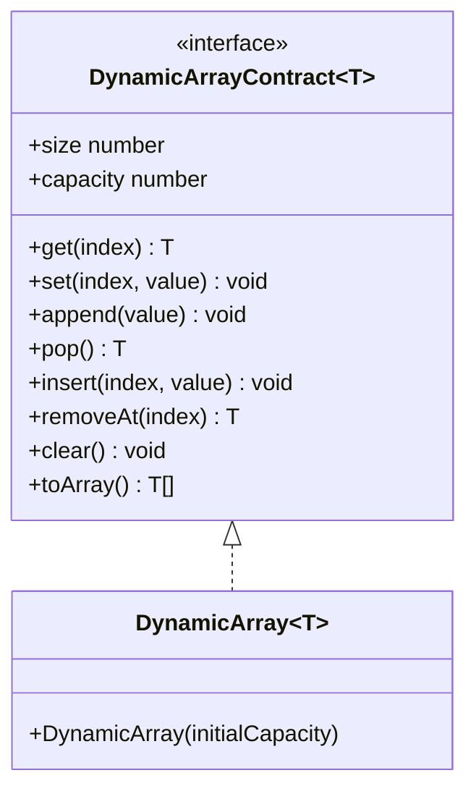
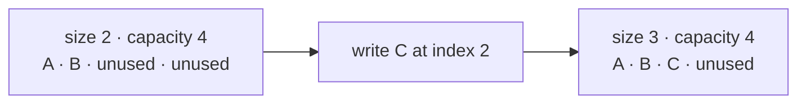
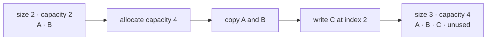
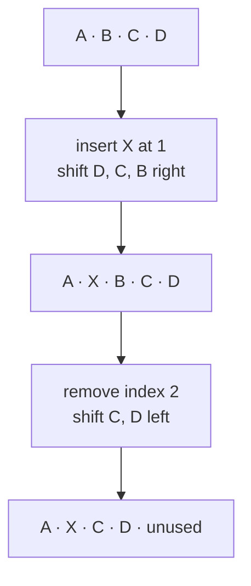

# Arrays And DynamicArray

An array stores values by numeric position. A dynamic array adds and removes logical values while
managing a separate storage capacity behind that indexed interface.

## Status

- Research audit complete
- Contract, proposed public API, diagrams, and tests ready for owner review
- Concrete `DynamicArray<T>` implementation intentionally incomplete
- Do not merge this checkpoint into `main`

## Why Build This

JavaScript already has `Array`, but its storage strategy is controlled by the runtime. Building
`DynamicArray<T>` makes the mechanics visible: logical size, unused capacity, geometric growth,
copying, shifting, and reference cleanup.

This implementation is for learning and for a small predictable collection API. It is not a claim
that a custom class will outperform native `Array`.

## Terms

- **Index:** zero-based logical position of a value.
- **Size:** number of values currently visible to callers.
- **Capacity:** number of positions available before storage must grow.
- **Growth:** allocation of larger storage followed by copying logical values.
- **Shift:** moving values right for insertion or left for removal.

For this topic, `n` means the logical size before an operation begins.

## Contract

`DynamicArray<T>` is a mutable, ordered, zero-indexed collection with these rules:

1. Logical indexes are contiguous from `0` through `size - 1`.
2. `capacity` is always greater than or equal to `size`.
3. `get`, `set`, and `removeAt` accept only integer indexes in `[0, size)`.
4. `insert` accepts only integer indexes in `[0, size]`; inserting at `size` appends.
5. Invalid capacities and indexes throw `RangeError`.
6. Stored `undefined` is a real value, not an invalid-index signal.
7. Growth from zero creates capacity `1`; later growth doubles capacity.
8. Removal and `clear` do not reduce capacity automatically.
9. Removed logical positions must stop retaining their previous values.
10. Iteration and snapshots expose only logical values in index order.
11. Structural mutation during active iteration is outside the first contract.

## Proposed Public API

```ts
interface DynamicArrayContract<T> extends Iterable<T> {
  readonly size: number;
  readonly capacity: number;

  isEmpty(): boolean;
  get(index: number): T;
  set(index: number, value: T): void;
  append(value: T): void;
  pop(): T | undefined;
  insert(index: number, value: T): void;
  removeAt(index: number): T;
  clear(): void;
  toArray(): T[];
}

class DynamicArray<T> implements DynamicArrayContract<T> {
  constructor(initialCapacity?: number);
}
```

The default initial capacity is `0`. A supplied capacity must be a nonnegative integer no greater
than `2^32 - 1`, the maximum JavaScript Array length. Allocation can still fail when the runtime
cannot provide the requested storage.

## Structure

This is the specification checkpoint, so the diagram names the real public declarations but does
not pretend that private implementation fields already exist.



After the owner implementation is written, add its real private field names and storage mapping to
this diagram.

## Append Without Growth

When `size < capacity`, append writes at index `size` and then increases `size`.



## Append With Growth

When storage is full, allocate double the previous capacity, copy the logical values, append the
new value, and replace the old storage. Capacity zero grows to one rather than remaining zero.



## Insert And Remove

Insertion opens one position by shifting values right from the end toward the insertion index.
Removal closes a position by shifting later values left, then clears the old final logical slot.



Shift direction matters. Moving right from the insertion index forward would overwrite values
before they had been copied.

## Expected Complexity

| Operation | Time | Additional space | Why |
|---|---:|---:|---|
| `size`, `capacity`, `isEmpty` | Worst-case `O(1)` | `O(1)` | Read stored metadata. |
| `get`, `set` | Worst-case `O(1)` | `O(1)` | Access a checked position. |
| `append` | Amortized `O(1)`; worst-case `O(n)` | Usually `O(1)`; growth `O(n)` | Growth occasionally copies all values. |
| `pop` | Worst-case `O(1)` | `O(1)` | Remove the final value without shrinking. |
| `insert` | Worst-case `O(n)` | Growth may use `O(n)` | Later values shift right. |
| `removeAt` | Worst-case `O(n)` | `O(1)` | Later values shift left. |
| `clear` | Worst-case `O(n)` | `O(1)` | Release each logical value reference. |
| iteration | Worst-case `O(n)` | `O(1)` iterator state | Visit each logical value. |
| `toArray` | Worst-case `O(n)` | `O(n)` | Return a new outer array. |

The retained structure uses `O(capacity)` storage. Big O does not show the unused positions, so
`size` and `capacity` remain separately visible.

## Trade-Offs

### Doubling Growth

Doubling makes append easy to reason about and provides amortized `O(1)` time. It may retain close
to the current size in unused positions immediately after growth. Other growth factors trade fewer
unused positions for more frequent copying.

### No Automatic Shrinking

Keeping capacity after removal makes `pop`, `removeAt`, and `clear` predictable and avoids resize
oscillation. A collection that once held many values can retain a large backing allocation. A later
topic revision may add an explicit shrink operation if a real use case justifies it.

### Checked Access

Throwing `RangeError` makes invalid positions distinct from a valid stored `undefined`. Callers who
need optional access can check `size` before reading.

### Native Array As Backing Storage

The implementation may use a JavaScript `Array` as its storage mechanism, but it must manage the
logical size and capacity itself. The contract does not promise a particular engine memory layout
or that this custom class is faster than native `Array`.

If growth would exceed the maximum JavaScript Array length, the operation throws `RangeError`
rather than wrapping or reporting a capacity smaller than the logical size.

## Test Coverage Prepared

The contract tests cover:

- default, custom, and invalid capacities;
- empty state and valid stored `undefined`;
- checked reads and replacements;
- growth from zero and exact doubling transitions;
- insertion at the beginning, middle, and end;
- removal at the beginning, middle, and end;
- empty and non-empty `pop`;
- capacity preservation after removal and `clear`;
- ordered iteration and independent snapshots;
- object identity; and
- a mixed operation sequence that checks state after several transitions.

Tests intentionally fail while the class shell is unimplemented.

## Traceability

| Concern | Source of truth |
|---|---|
| Behavior contract | `packages/algohatch/src/array/dynamic-array-contract.ts` |
| Owner implementation shell | `packages/algohatch/src/array/dynamic-array.ts` |
| Contract and transition tests | `packages/algohatch/test/dynamic-array.test.ts` |
| Root export check | `packages/algohatch/test/public-api.test.ts` |
| Built-package type validation | `tools/validation/src/array.ts` |

After implementation, update the structure diagram and this mapping if the real code uses different
names or introduces behavior not covered here.

## Owner Exercise

Implement `DynamicArray<T>` in the provided class shell without changing the public contract first.
Use the tests as executable requirements. If a requirement appears impractical or unclear, stop and
change the contract deliberately before changing the test merely to make it pass.
