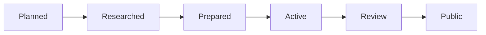

# Exercise Lifecycle

AlgoHatch prepares the curriculum before owner implementation. A prepared exercise contains enough
context to begin later without redesigning the topic, while remaining dormant and non-public.

## States

- **Planned:** listed in the curriculum but not yet researched.
- **Researched:** private research record completed; public material may now be drafted.
- **Prepared:** proposed contract, incomplete source shell, guidance, diagrams, and skipped tests are
  ready. Nothing is exported.
- **Active:** the owner removes `.skip` and implements the exercise. Failing tests are expected.
- **Review:** behavior passes and the implementation is checked against the contract and diagrams.
- **Public:** reviewed declarations are intentionally exported and package validation covers them.

## Prepared Exercise Rules

1. Keep each topic README, contract, source shells, and tests together under
   `packages/algohatch/src/data-structures` or `packages/algohatch/src/algorithms`.
2. Give each algorithm its own source file. Compatible data-structure implementations share one
   clearly named ADT family and contract, but every independently named implementation gets its own
   child folder containing its source and `README.md`. Keep single-implementation topics flat.
3. Import shells directly from colocated skipped tests; do not export them from `src/index.ts`.
4. Use comments for implementation order, boundary cases, and common mistakes, not completed loops.
5. Keep proposed APIs small and mark them pre-implementation in topic documentation.
6. Recheck research and the proposed API when activating an older exercise.
7. Activate one coherent topic or tightly connected group at a time.
8. Add a Changeset only when reviewed behavior becomes public.

Skipping is a staging mechanism, not evidence that an exercise works. Repository validation should
stay green while the curriculum is prepared.
