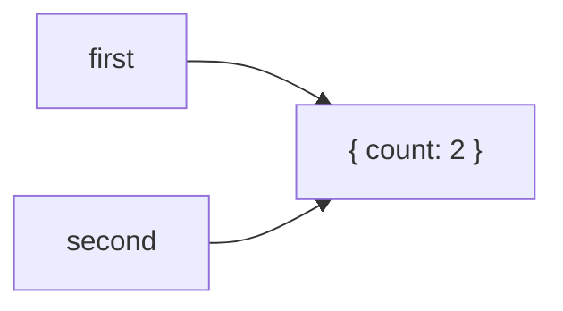
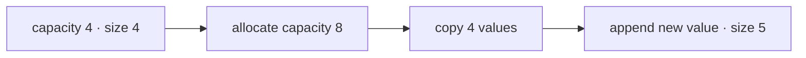
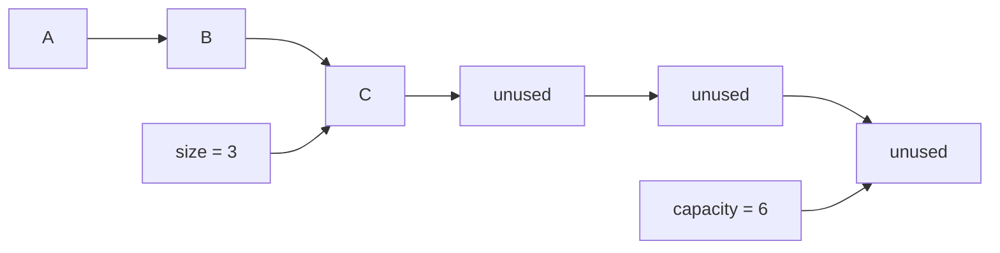
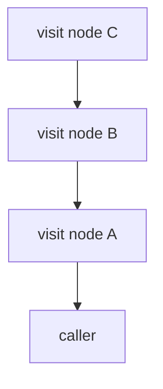

# Practical Foundations

These foundations explain the JavaScript and complexity concepts used by later data structures.
They are not a separate library API. Small examples make the behavior concrete; actual data
structure implementations begin with arrays and `DynamicArray<T>`.

## Status

- Public draft revised after private research audit
- Owner review pending

## Values, Variables, And Assignment

A variable is a name through which a value can be read. Assignment changes which value that name
refers to.

Primitive values such as numbers, strings, booleans, `null`, and `undefined` behave independently
after assignment:

```ts
let first = 10;
let second = first;

second = 20;

first; // 10
second; // 20
```

Objects, arrays, functions, maps, and sets have identity. Assigning an object value to another
variable does not clone it. Both variables can hold the same object value and observe mutations to
that object:

```ts
const first = { count: 1 };
const second = first;

second.count = 2;

first.count; // 2
first === second; // true
```



This matters for linked structures: a node's `next` field refers to another node; it does not
contain an independent copy of that node.

## Identity, Equality, And Copies

Two objects with identical contents are still different objects:

```ts
const left = { value: 1 };
const right = { value: 1 };

left === right; // false
```

An array spread creates a new outer array, but nested objects remain shared:

```ts
const original = [{ value: 1 }];
const copy = [...original];

copy === original; // false
copy[0] === original[0]; // true
```

When an API promises a snapshot, it must say whether that means a new container, recursively
copied values, or immutable values. AlgoHatch collection `toArray()` methods currently promise a
new outer array, not deep cloning.

## Equality, Ordering, And Hashing

Data structures need an explicit rule for deciding whether values are equal or ordered.

JavaScript has several built-in equality rules. Strict equality (`===`) compares object identity,
treats `NaN` as unequal to itself, and treats positive and negative zero as equal. Native `Map`
and `Set` use a related rule under which `NaN` matches `NaN`. A custom collection must state which
rule it uses rather than saying only “values are equal.”

Sorted structures usually accept a comparator:

```ts
type Comparator<T> = (left: T, right: T) => number;

const byNumber: Comparator<number> = (left, right) => left - right;
```

A valid comparator must be consistent: equal values compare as zero, reversing arguments reverses
the ordering, and comparisons must not contradict one another. Mutable keys are dangerous because
changing a key after insertion can break the conditions that keep a sorted or hashed structure
correct.

Hash-based structures add another requirement: values considered equal must produce compatible
hashes. JavaScript does not provide a general built-in hash function for arbitrary user values, so
future custom hash structures must define their equality and hashing boundaries explicitly.

## Mutation And Observable Behavior

Mutation changes an existing object. A non-mutating operation instead creates a different value.

```ts
const values = [1, 2];

values.push(3); // mutates values
const extended = [...values, 4]; // creates a new array
```

Neither style is universally better. Data structures are usually mutable because operations such
as enqueue and dequeue are expected to update the same structure. Public contracts must make that
behavior clear.

Private class fields help protect internal state from direct external mutation:

```ts
class Counter {
  #value = 0;

  public increment(): void {
    this.#value += 1;
  }
}
```

Privacy does not make an object immutable; it controls where mutations can be performed.

## JavaScript Arrays

JavaScript `Array` is an ordered, mutable, dynamically sized object with integer-like property
names and a special `length` property. It is useful for implementing data structures, but code
should not claim that every JavaScript engine stores every array as one simple contiguous memory
block. Engines can choose different internal representations.

```ts
const values = ["A", "B"];

values[0]; // "A"
values.length; // 2

values.push("C");
values.length; // 3
```

Setting an index beyond the current end changes `length` and creates empty positions:

```ts
const values: string[] = [];
values[3] = "D";

values.length; // 4
0 in values; // false: the position is empty, not an explicit undefined value
```

Sparse arrays can behave differently across array operations. Data-structure implementations
should normally maintain dense logical storage unless sparsity is deliberate. Array iteration
reads positions in index order, but individual array methods do not all treat empty positions the
same way; avoid relying on holes as if they were normal stored values.

## Indexed Access

An index identifies a position. In the conventional array data-structure model, reading or
replacing a known position takes constant time, written `O(1)`.

```ts
const values = ["A", "B", "C"];

values[1]; // read B
values[1] = "updated"; // replace B
```

TypeScript cannot prove that a numeric index is within bounds. This repository enables
`noUncheckedIndexedAccess`, so indexed reads include `undefined` unless the code establishes that
the position exists.

```ts
const first = values[0]; // string | undefined
```

Indexed access is not the same operation as searching by value. Finding an unknown value may need
to inspect every position and therefore takes `O(n)` in the worst case.

ECMAScript specifies what an Array operation must make observable; it does not require a particular
in-memory representation or complexity. Complexity statements about JavaScript arrays are
therefore engineering expectations that should be phrased with that limitation.

## Iteration

Iteration visits a sequence one value at a time. Arrays are iterable, and custom structures can
support `for...of` by implementing `Symbol.iterator`.

```ts
for (const value of ["A", "B", "C"]) {
  console.log(value);
}
```

A generator is a convenient way to implement an iterator while preserving resumable state:

```ts
function* values(): IterableIterator<string> {
  yield "A";
  yield "B";
}
```

A full traversal of `n` values takes `O(n)` time. The loop may use `O(1)` additional state even
though it visits all values. Creating a copied array during traversal instead requires `O(n)`
additional space.

For mutable structures, changing the structure during iteration can make behavior difficult to
reason about. A contract should either define that behavior or explicitly leave it unsupported.

## Cost Models And Time Complexity

Time complexity describes how the amount of work grows as input size `n` grows. It does not state
an exact duration in milliseconds. Before analyzing an operation, decide what work is counted:
comparisons, indexed reads, assignments, allocations, or some other operation relevant to the
algorithm. This assumption is its cost model.

| Complexity | Growth intuition | Common example |
|---|---|---|
| `O(1)` | Work does not grow with `n` | Read a known array index |
| `O(log n)` | Work grows by the number of repeated halvings | Binary search |
| `O(n)` | Work grows in direct proportion to `n` | Traverse an array |
| `O(n log n)` | Near-linear work across logarithmic levels | Efficient comparison sorting |
| `O(n²)` | For each value, inspect roughly every value | Two full nested loops |

### Big-O, Big-Omega, And Big-Theta

These notations describe asymptotic growth as inputs become large:

| Notation | Practical reading |
|---|---|
| `O(f(n))` | The growth is asymptotically no greater than a constant multiple of `f(n)`. |
| `Ω(f(n))` | The growth is asymptotically no less than a constant multiple of `f(n)`. |
| `Θ(f(n))` | Both bounds hold, so `f(n)` describes the tight growth rate. |

Saying an operation is `O(n)` does not prove that it actually grows linearly; a constant-time
operation is also mathematically `O(n)`. Use a tight `Θ` statement when it is known and useful.
Library tables commonly use `O` to communicate an expected upper bound, so every table must name
the operation, define `n`, and state whether the bound is worst-case, expected, or amortized.

Two `O(n)` algorithms can have different real costs because of allocation, cache behavior,
runtime optimizations, and the amount of work performed in each step. Complexity is a reasoning
tool, not a timing result.

## Space Complexity

Space complexity describes how storage grows with input size. Be explicit about whether a table
describes total structure storage or additional temporary storage.

Examples:

- A collection holding `n` values uses `O(n)` total storage.
- Reading one array position uses `O(1)` additional space.
- Returning a copied array of all values uses `O(n)` additional space.
- A linked list uses `O(n)` nodes plus per-node link fields.

An implementation can have the same `O(n)` space complexity as another while retaining more
unused capacity or needing more metadata per value. Big-O intentionally ignores those constant
factors, so practical trade-offs should mention them separately.

## Best, Average, Worst, And Expected Cases

An operation can have different costs depending on the input or current state.

- **Best case:** the least work for any valid case.
- **Worst case:** the most work for any valid case.
- **Average case:** a mean over a clearly stated distribution of inputs or operation sequences.
- **Expected case:** expected work over a stated source of randomness, often choices made by the
  algorithm or data structure.

Do not write “average `O(1)`” without explaining what is being averaged. When no realistic input
distribution is known, worst-case or amortized analysis is usually clearer.

## Amortized Complexity

Amortized analysis provides a bound across an operation sequence by spreading occasional expensive
operations over many inexpensive ones. It does not require random inputs and does not mean
probabilistic, average-case, or merely “usually fast.”

Consider storage that doubles when full:



Most appends write one value. A growth append allocates larger storage and copies existing values,
which is `O(n)` for that operation. With geometric growth, enough inexpensive appends occur between
growth steps that append is amortized `O(1)` across a long sequence.

The offset-array Queue uses the same style of reasoning: most dequeues advance an index, while an
occasional compaction copies the remaining values.

An amortized bound does not change the worst case for one operation. A single growth append can
still take `Θ(n)` even when a sequence of appends costs `Θ(1)` per append when amortized.

## Logical Size And Capacity

**Size** is the number of values the caller can observe. **Capacity** is how many values current
internal storage can hold before growth is needed.



The unused positions are implementation details. Iteration, snapshots, and public size must expose
only the logical values. A `DynamicArray<T>` will make this distinction explicit.

## Allocation, Copying, And Reuse

Creating arrays or nodes allocates storage. Storage that is no longer reachable can later be
reclaimed by garbage collection; reclamation timing is not controlled by the data structure.

Implementation choices affect allocation patterns:

- A growing array occasionally allocates a larger backing array and copies values.
- A linked list allocates one node per inserted value.
- A circular buffer reuses positions after values are removed.
- An offset array can temporarily retain consumed positions until compaction.

These differences matter even when implementations share the same Big-O classification. Public
documentation should explain the pattern without promising runtime-specific memory layouts or
garbage-collection timing.

## Locality And Runtime Representation

Values stored near one another in memory can sometimes be processed more efficiently because
processors and runtimes reuse nearby data. This is called locality. Conventional arrays often
benefit from locality, while linked nodes may be allocated in separate places and require pointer
following.

That comparison is a useful engineering expectation, not a JavaScript language guarantee. Engines
may represent arrays differently depending on their contents and usage. AlgoHatch should discuss
locality as a possible practical factor and avoid claiming a specific engine layout without direct
evidence for the tested runtime.

## Call Stack, Iteration, And Recursion

Every function call needs execution state. Nested calls accumulate on the call stack until they
return.



A recursive traversal with depth `d` uses `O(d)` call-stack space. An iterative version may use an
explicit Stack or Queue instead. Moving state from the call stack into a collection does not make
the state disappear; it changes where and how it is represented.

JavaScript runtimes have finite call stacks, so deeply recursive implementations can fail even
when their algorithm is otherwise correct. AlgoHatch should use recursion when it improves the
explanation and expected depth is appropriate, and use iteration when depth can grow large.

## Recurrence Relations

A recurrence describes work in terms of smaller instances of the same problem. For example,
binary search examines one half after constant work:

```text
T(n) = T(n / 2) + Θ(1)
```

Repeated halving gives `T(n) = Θ(log n)`. Merge sort solves two half-size problems and performs
linear merge work:

```text
T(n) = 2T(n / 2) + Θ(n)
```

This gives `T(n) = Θ(n log n)`.

For divide-and-conquer recurrences shaped like `T(n) = aT(n / b) + Θ(n^c)`, the introductory
Master Theorem compares `n^c` with `n^(log_b a)`. It is a useful shortcut for matching recurrences,
not a universal rule for every recursive algorithm. We will apply it when divide-and-conquer topics
arrive rather than memorizing cases without context.

## Bitwise Operations In JavaScript

Bitwise operations can represent flags, bit sets, masks, and compact integer state. In ordinary
JavaScript bitwise operators, Number operands are converted to signed 32-bit integers (or unsigned
32-bit for `>>>`) before the operation. Values outside that range can therefore lose high bits.

```ts
const read = 1 << 0;
const write = 1 << 1;
const permissions = read | write;

(permissions & write) !== 0; // true
```

`BigInt` has separate bitwise operations for larger integer values and cannot be mixed directly
with Number operands. Use bitwise techniques only when their range and readability are explicit.

## How These Foundations Guide Implementations

| Later topic | Foundation it depends on |
|---|---|
| Dynamic array | Indexed access, size/capacity, copying, amortized growth |
| Linked list | References, identity, allocation, traversal |
| Stack | Mutation, array or linked storage, call-stack comparison |
| Queue | Front/back order, shifting, offsets, circular indexes, links |
| Trees and graphs | References, recursion, explicit Stack/Queue traversal |
| Sorting and searching | Indexed access, iteration, time and space analysis |
| Ordered and hashed structures | Equality, comparators, hashing, mutable-key risks |
| Divide and conquer | Recurrences and introductory Master Theorem reasoning |
| Bit sets and masks | JavaScript's numeric conversion rules for bitwise operations |

## Review Checkpoint

Before implementing `DynamicArray<T>`, the owner should be able to explain:

1. Why assigning an array does not clone it.
2. Why a shallow copy can still share nested objects.
3. Why indexed access and searching are different operations.
4. What the cost model and `n` mean in a complexity statement.
5. The difference between `O`, `Ω`, and `Θ`.
6. The difference between average, expected, worst-case, and amortized cost.
7. The difference between logical size and internal capacity.
8. Why two implementations with the same asymptotic bound can behave differently in practice.
9. Why recursion consumes space even when no explicit collection is created.
10. What a recurrence describes and when the Master Theorem is relevant.
11. Why equality, comparator, and hashing rules belong in collection contracts.
12. Why JavaScript bitwise operations need an explicit integer-range check.

After this review, continue with the Array topic and the `DynamicArray<T>` contract.
