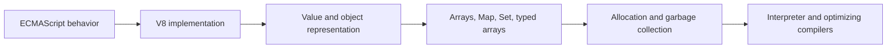
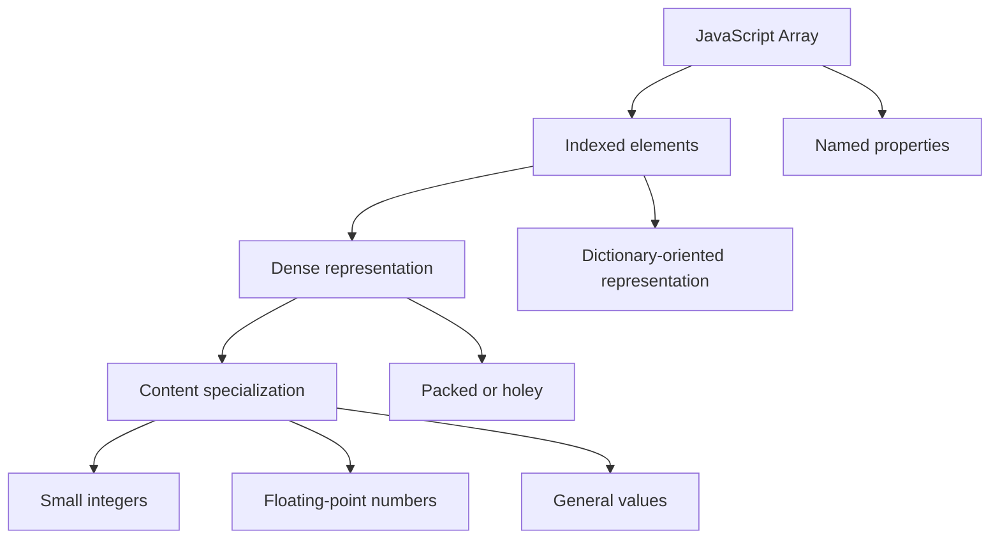

# V8 Runtime Notes

V8 is a production JavaScript engine used by Chromium and embeddable in other runtimes. These notes
connect AlgoHatch's data-structure learning path to selected engine internals without treating one
engine's choices as JavaScript language rules.

## Status And Scope

- Last verified: 2026-10-14
- Current chapter: Arrays
- Planned when relevant: objects and shapes, `Map`, `Set`, typed arrays, garbage collection, and
  the execution pipeline
- Not an implementation target for AlgoHatch

ECMAScript defines observable JavaScript behavior. V8 decides how to produce that behavior within
its own performance, memory, portability, and maintenance constraints. Another compliant engine
may make different internal choices.

## Source And Maintenance Policy

These notes use official V8 documentation and repository material. AlgoHatch writes original
summaries and diagrams; it does not copy V8 code, tests, prose, diagrams, or benchmark results.

Every chapter must:

1. include a verification date;
2. distinguish ECMAScript behavior from V8 implementation details;
3. link directly to the official material supporting its claims;
4. avoid depending on unstable internal class or field names unless they are essential;
5. explain what the observation teaches rather than presenting engine trivia alone; and
6. be rechecked when the connected AlgoHatch topic is materially revised.

The V8 project is primarily BSD-3-Clause licensed and identifies separately licensed third-party
areas in its repository. The v8.dev website source is Apache-2.0 licensed. AlgoHatch links to those
projects and independently summarizes selected concepts rather than redistributing their material.

## Learning Map



This order keeps language guarantees separate from increasingly engine-specific mechanisms.

## Arrays

Verified: 2026-10-14

### Language View

A JavaScript `Array` has special behavior for indexed properties and `length`. ECMAScript does not
require a particular memory layout, backing-store capacity, or element representation. Therefore,
neither AlgoHatch nor its callers should infer those details from normal Array behavior.

### Indexed And Named Properties

V8 distinguishes integer-indexed elements from named object properties. This lets it optimize
common indexed operations separately while still preserving JavaScript's object semantics.

```ts
const values = [10, 20];
values[2] = 30; // Indexed element
values.label = "scores"; // Named property
```

Both belong to one JavaScript object from the program's perspective, but V8 may represent them
through different internal stores.

### Element Representations

V8 tracks an array's element representation so it can specialize common cases. Important
high-level distinctions include:

- values that can use V8's small-integer representation;
- numeric values requiring a floating-point representation;
- general values such as objects and strings;
- packed indexed elements with no missing positions;
- holey indexed elements with missing positions; and
- dense indexed storage versus a dictionary-oriented representation for sufficiently sparse or
  otherwise complicated cases.

These categories can change as an array is modified. Their exact set and transition rules are V8
implementation details and may evolve.



This diagram is an AlgoHatch learning model, not a reproduction of V8's complete element-kind
transition graph.

### Why Holes Matter

A hole means that an indexed property is absent. It is not the same as storing `undefined` at that
index. When an indexed property is absent, JavaScript semantics may require looking farther along
the prototype chain. V8 can optimize packed arrays more directly because that missing-property
case does not occur within their indexed range.

```ts
const holey = [10, , 30];
const explicit = [10, undefined, 30];

0 in holey; // true
1 in holey; // false
1 in explicit; // true
```

### What AlgoHatch Learns

1. Native JavaScript `Array` should not be described as merely a textbook contiguous array.
2. Observable behavior belongs in the public contract; engine storage choices do not.
3. Holes and stored `undefined` must remain conceptually distinct.
4. A learning implementation can use a regular Array as backing storage while managing its own
   logical size and private growth policy.
5. V8's specialized representations solve engine-wide concerns that a generic TypeScript
   `DynamicArray<T>` should not attempt to reproduce.

This supports AlgoHatch's decision to keep `DynamicArray` capacity and exact growth policy private.

### How V8 Tests Related Behavior

V8 maintains JavaScript-level tests, regression collections, C++ tests for engine internals, and
integration with Test262 for ECMAScript conformance. The useful lesson for AlgoHatch is the
separation of test responsibilities:

- public tests verify behavior callers can observe;
- focused implementation tests cover internal transitions when necessary; and
- standards conformance and engine-specific correctness are not treated as the same layer.

AlgoHatch adopts that separation at library scale without copying V8's test framework or cases.

### Official Sources

- [V8: Elements kinds](https://v8.dev/blog/elements-kinds)
- [V8: Fast properties](https://v8.dev/blog/fast-properties)
- [V8 JavaScript tests](https://chromium.googlesource.com/v8/v8/+/refs/heads/main/test/mjsunit/)
- [V8 C++ tests](https://github.com/v8/v8/tree/main/test/cctest)
- [V8 repository license](https://github.com/v8/v8/blob/main/LICENSE)
- [v8.dev website license](https://github.com/v8/v8.dev/blob/main/LICENSE)

## Future Chapters

Add a chapter only when it supports an active AlgoHatch topic or the runtime learning sequence.
Likely connections include:

- objects, shapes, and V8's internal use of the term `Map`;
- JavaScript `Map` and `Set` representation, hashing, ordering, deletion, and resizing;
- `ArrayBuffer` and typed-array views;
- weak collections and garbage-collection reachability; and
- Ignition, feedback, optimization, and deoptimization after the storage topics are established.

Before adding an exact internal claim, verify it against current official material rather than
carrying forward an older implementation detail from memory.
