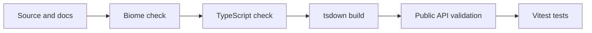

# Tooling Guide

This page explains the repository tools, where each one is configured, and why it is present.
The goal is a small, understandable toolchain rather than configuration for its own sake.

## Validation Flow



Run the complete flow with:

```sh
pnpm check
```

## pnpm Workspaces

pnpm installs dependencies and links workspace packages. `pnpm-workspace.yaml` includes:

- `packages/*` for publishable packages
- `tools/*` for private development projects such as public API validation

The root `package.json` is private and coordinates commands. `packages/algohatch/package.json`
describes the package users will eventually install. Package JSON files remain strict JSON
because package managers do not generally accept comments there.

Important root commands:

| Command | Purpose |
|---|---|
| `pnpm biome:check` | Check formatting, lint rules, and imports. |
| `pnpm biome:format` | Apply safe formatting and import fixes. |
| `pnpm typecheck` | Type-check the library without producing output. |
| `pnpm build` | Build publishable JavaScript and declarations. |
| `pnpm validation:typecheck` | Verify the built public import paths and types. |
| `pnpm test` | Run the package tests. |
| `pnpm check` | Run all checks in dependency order. |
| `pnpm changeset` | Record the SemVer impact and user-facing summary of a package change. |
| `pnpm package:check` | Pack, inspect, install, and execute the npm artifact. |
| `pnpm release:check` | Run both the development checks and package artifact validation. |
| `pnpm version-packages` | Apply pending Changesets to versions and changelogs without publishing. |

## TypeScript

TypeScript checks source types and defines the JavaScript/module assumptions shared by the
package and validation project. `tsconfig.base.json` contains the common rules.

| Option | Meaning in this project |
|---|---|
| `target: ES2022` | Assume a modern JavaScript runtime and syntax level. |
| `lib: [ES2022]` | Include the standard ES2022 type definitions. |
| `module: NodeNext` | Model Node.js ESM and CommonJS interpretation rules. |
| `moduleResolution: NodeNext` | Resolve imports the way modern Node.js does. This is why local TypeScript imports use `.js` endings. |
| `strict` | Enable TypeScript's main strictness checks. |
| `declaration` | Allow the library build to create consumer-facing `.d.ts` files. |
| `declarationMap` | Let editors map declaration types back to their TypeScript source. |
| `sourceMap` | Let built JavaScript map back to TypeScript while debugging. |
| `noUncheckedIndexedAccess` | Treat `array[index]` as possibly missing. |
| `exactOptionalPropertyTypes` | Keep a missing property distinct from a property explicitly set to `undefined`. |
| `useDefineForClassFields` | Match modern JavaScript class-field behavior. |
| `isolatedModules` | Ensure each file can be transformed independently by build tools. |
| `verbatimModuleSyntax` | Keep type-only and runtime imports explicit. |
| `skipLibCheck` | Skip rechecking dependency declaration internals while still checking project code. |
| `forceConsistentCasingInFileNames` | Prevent imports that only work on case-insensitive file systems. |

`packages/algohatch/tsconfig.json` includes source, tests, and the build configuration for type
checking. The package's `typecheck` command uses `--noEmit`, so tsdown remains responsible for
build output.

`tools/validation/tsconfig.json` also uses `noEmit`: validation only needs to prove that a
separate TypeScript project can use the public package declarations.

TypeScript configuration files accept comments even though their extension is `.json`.

## tsdown

tsdown builds the library as ESM JavaScript and generates declaration files. Its configuration is
TypeScript, which makes supported options type-checked.

- `entry` builds the single public `algohatch` import.
- `format: "esm"` produces ECMAScript modules.
- `dts` produces declaration files and declaration source maps.
- `sourcemap` produces JavaScript source maps.
- `clean` removes stale output before each build.

Topic folders remain internal organization. New structures are exported from the root entry unless
a measured consumer need justifies introducing another permanent public import path.

## Vitest

Vitest runs colocated files under `packages/algohatch/src` whose names end in `.test.ts`. The
package uses:

- A public-surface check while prepared exercises intentionally remain unexported
- Skipped exercise suites that compile during curriculum preparation
- Activated shared contract tests for behavior every compatible implementation must satisfy
- Focused tests for implementation-specific transitions and correctness rules

Skipped suites are temporary curriculum staging. Activate one topic at a time; never treat a
skipped test as evidence of working behavior.

The `threads` pool allows test files to run in worker threads. Tests should not depend on shared
mutable global state or execution order.

## Biome

Biome provides formatting, linting, and import organization through one tool.

- Two-space indentation and a 100-character line width keep formatting consistent.
- Recommended lint rules catch broadly useful correctness and maintainability issues.
- Import organization keeps imports deterministic.
- Generated output, dependencies, and the lockfile are excluded.

`biome.json` remains strict JSON. Explanations live here instead of changing its format solely to
embed comments.

## Public API Validation

`tools/validation` is a private workspace project that imports the built package exactly through
its public names. Internal source tests can pass even when a package export or declaration file is
wrong; this project checks that boundary.

`src/package.ts` proves that the base package resolves before the first data structure exists.
Each later public topic owns one additional source file, such as `src/array.ts`. That file imports
the topic from the package root, constructs the public classes, and assigns them to their public
contracts. TypeScript includes every file under `src`, so no `index.ts`, result object, or runtime
harness is needed.

When `DynamicArray<T>` becomes public, validation adds `src/array.ts`.

## Automated Validation

`.github/workflows/validate.yml` installs the locked dependency versions and runs `pnpm check` on
pull requests and pushes to `main`. The workflow has read-only repository permissions, a bounded
runtime, and immutable commit pins for third-party Actions.

## Package And Release Validation

`tools/release/validate-package.mjs` verifies the artifact users will actually install rather than
only checking source files. It:

1. Runs the package's `prepack` build and creates a temporary `.tgz` archive.
2. Runs publint against the archive's package metadata and export map.
3. Checks the declarations and module-resolution behavior with Are the Types Wrong.
4. Installs the archive into a temporary ESM project without contacting the registry.
5. Confirms the README, MIT license, and root entry point are present.
6. Executes the public root import and confirms its intended export surface.
7. Deletes the temporary project and archive.

Run this artifact check together with all development checks using `pnpm release:check`. It does
not publish, tag, push, or modify a package version.

Changesets stores one small Markdown file per user-visible package change. The file records which
package changes, whether the next version is a patch, minor, or major release, and the release-note
summary. `pnpm version-packages` consumes those files when preparing a reviewed version update.

Release preparation is manual while the package and release cadence are still small. Run
`pnpm version-packages`, review its version and changelog changes, then run `pnpm release:check`.
There is no workflow with npm credentials, OIDC publish permission, or a publish command.

Before the first release, the owner still needs to sign in to npm with two-factor authentication
and approve the initial publication. Trusted publishing can be connected afterward. These identity
and account operations must not be guessed or automated by a coding agent.
