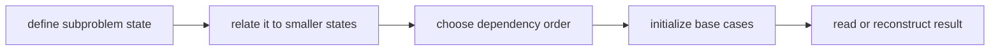

# Dynamic Programming

**Status:** research-audited exercise specifications; implementations and tests remain skipped and
are not public.

Dynamic programming solves overlapping subproblems once and evaluates them in dependency order. It
is not “use a table”: the state must retain exactly the information a later decision needs.

| Exercise | DP family | Result | Expected cost |
|---|---|---|---:|
| 0/1 knapsack | capacity / pseudo-polynomial | maximum value | `O(nC)` time, `O(C)` space |
| minimum coins | amount | minimum count or `undefined` | `O(amount * coins)` time |
| LIS | sequence tails + predecessors | one strict subsequence | `O(n log n)` time |
| LCS | two-sequence suffixes | one common subsequence | `O(mn)` time/space |
| edit distance | two-sequence prefixes | operation count | `O(mn)` time |
| grid path | grid DAG | minimum sum | `O(rows * columns)` time |
| tree independent set | include/exclude tree states | maximum weight | `O(n)` time/space |
| matrix chain | interval | minimum operation count | `O(n^3)` time |
| traveling salesperson | subset/bitmask | minimum tour cost | `O(n^2 2^n)` time |

## Topic Pages

- [DP Foundations](./foundations.md)
- [0/1 Knapsack](./zero-one-knapsack.md)
- [Minimum Coin Count](./minimum-coin-count.md)
- [Longest Increasing Subsequence](./longest-increasing-subsequence.md)
- [Longest Common Subsequence](./longest-common-subsequence.md)
- [Edit Distance](./edit-distance.md)
- [Minimum Grid Path Sum](./minimum-grid-path-sum.md)
- [Maximum-Weight Independent Set On A Tree](./maximum-tree-independent-set-weight.md)
- [Matrix-Chain Cost](./matrix-chain-cost.md)
- [Traveling Salesperson](./traveling-salesperson.md)

The proposed signatures live in `dynamic-programming.contract.ts`. Every algorithm has its own
commented shell and colocated skipped test; no combined implementation file is used.
