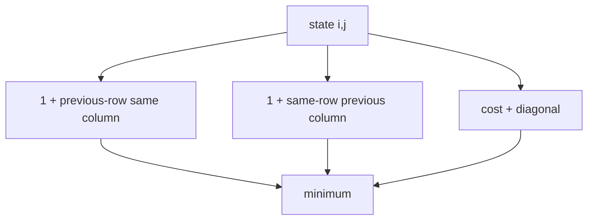

# Edit Distance

`editDistance` returns the minimum count of single-element insertions, deletions, and substitutions.
Elements are Unicode code points obtained by string iteration, not UTF-16 code units or user-visible
grapheme clusters. Text is not normalized.

Empty-prefix base states equal the other prefix length. Matching code points use zero substitution
cost; different points use one. Time is `O(mn)`. Because only the previous row is needed for a
cost-only result, space can be `O(min(m,n))`.

**Code mapping:** `edit-distance.ts` and `edit-distance.test.ts`.
