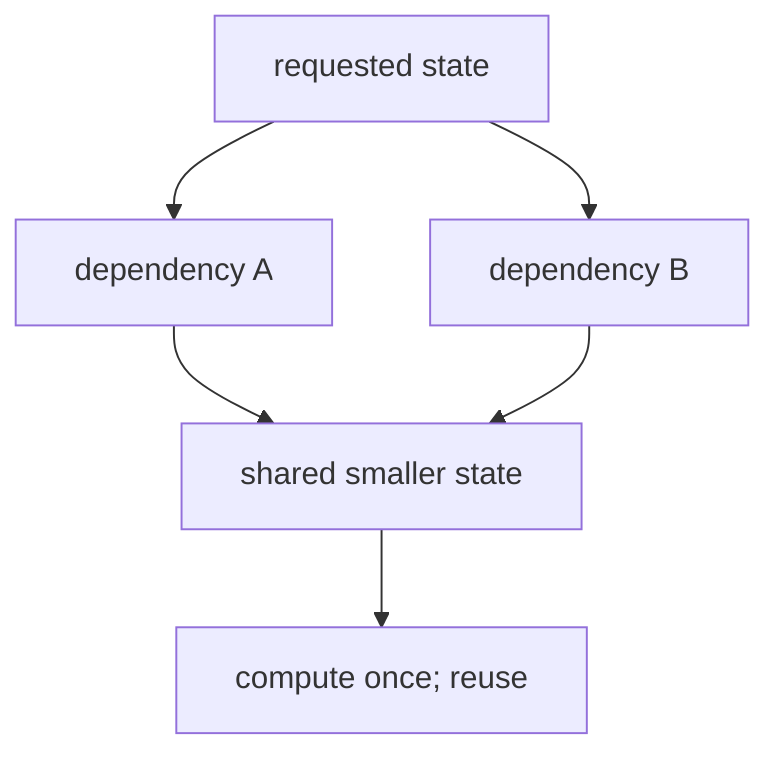

# Dynamic Programming Foundations

Use dynamic programming when subproblems overlap and their dependencies form an acyclic graph.

1. **State:** say in one sentence what one table entry means.
2. **Transition:** express that state using smaller states.
3. **Base cases:** define states with no remaining decision.
4. **Order:** memoize recursive calls or tabulate after dependencies.
5. **Result:** identify the requested state and reconstruct choices only when the API returns them.
6. **Cost:** count states times work per state, plus reconstruction.

Top-down memoization often mirrors the recurrence and can skip unreachable states. Bottom-up
tabulation makes evaluation order and memory compression easier to inspect. They solve the same
state graph when they use the same recurrence and base cases.

Space optimization is valid only after checking which earlier states the next transition reads.
Reversing an update loop can change the problem: the downward capacity loop in 0/1 knapsack blocks
same-item reuse, while an upward loop would describe unlimited reuse.
