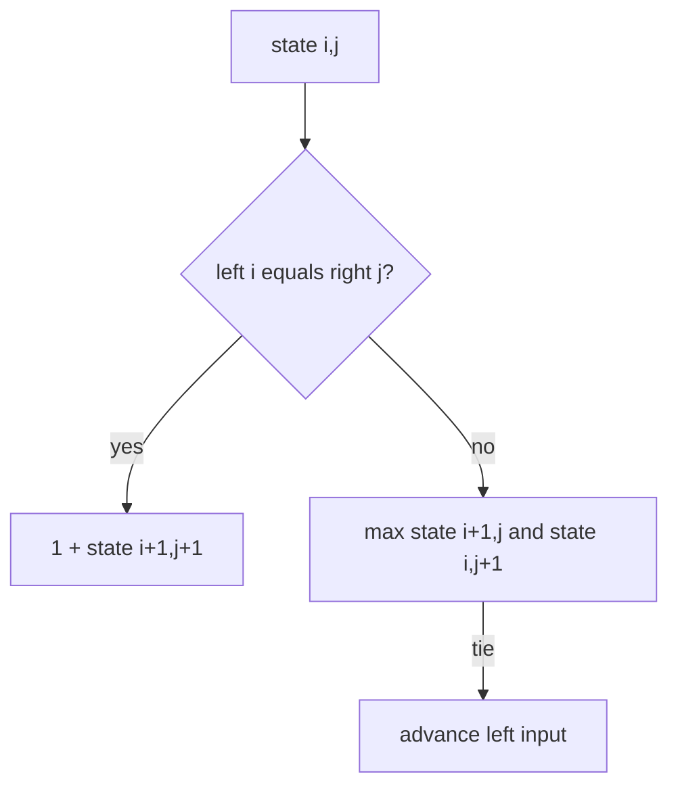

# Longest Common Subsequence

LCS preserves order but does not require contiguous elements. Elements compare with SameValueZero,
so `NaN` matches `NaN` and signed zeroes match.

A suffix table makes reconstruction start at `(0,0)`. Equal elements are emitted. Otherwise the
larger remaining state is followed; ties advance in the left input first. Time and table space are
`O(mn)`, while output reconstruction is `O(m + n)`.

**Code mapping:** `longest-common-subsequence.ts` and `longest-common-subsequence.test.ts`.
