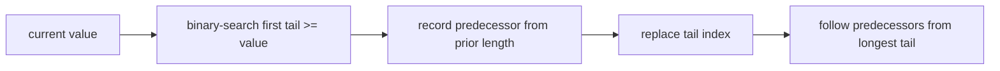

# Longest Increasing Subsequence

The result is a strictly increasing subsequence of finite input values; equal values cannot extend
it. Empty input returns an empty result.

`tails[length]` stores the input index of the smallest known final value for that subsequence
length. Lower-bound replacement, including later equal values, defines deterministic tie behavior.
Predecessors reconstruct one actual subsequence. Time is `O(n log n)` and extra space `O(n)`.

**Code mapping:** `longest-increasing-subsequence.ts` and
`longest-increasing-subsequence.test.ts`.
