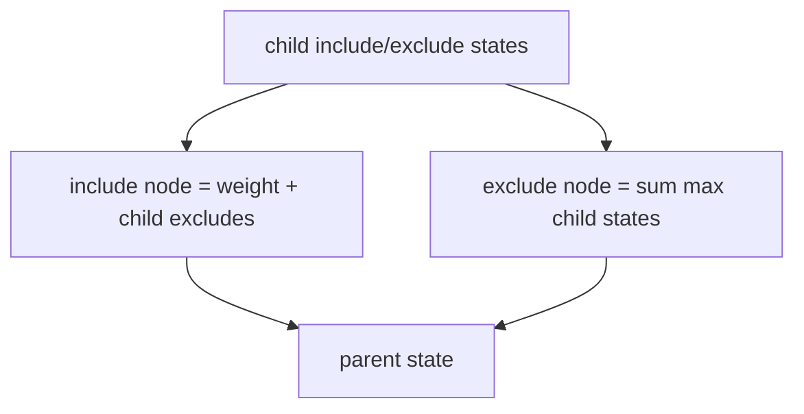

# Maximum-Weight Independent Set On A Tree

The tree is encoded by aligned `parents` and `weights` arrays. Empty arrays describe an empty tree.
Otherwise index zero is the root with parent `-1`; each later parent is a safe index smaller than
its child index. This parent-before-child rule gives a ready bottom-up order.

No selected node may have a selected parent or child. Finite weights may be negative, and the empty
selection keeps the answer at least zero. Each node and parent edge is processed once: `O(n)` time
and `O(n)` state space.

**Code mapping:** `maximum-tree-independent-set-weight.ts` and its matching test file.
