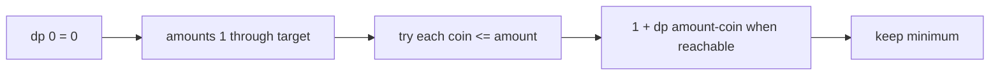

# Minimum Coin Count

Coin denominations are positive safe integers and may be reused without limit. Amount is a
nonnegative safe integer. Amount zero needs zero coins; an impossible positive amount returns
`undefined`.

Duplicate denominations do not change the answer. There are `amount + 1` states and each tries all
coins: `O(amount * coinCount)` time and `O(amount)` space.

**Code mapping:** `minimum-coin-count.ts` and `minimum-coin-count.test.ts`.
