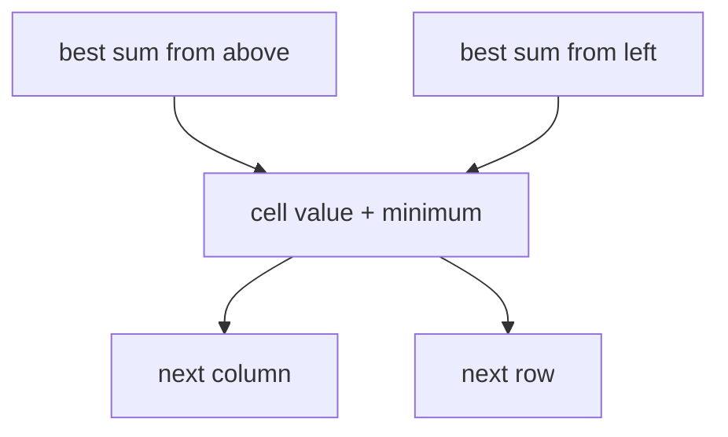

# Minimum Grid Path Sum

The path starts at the top-left cell, ends at the bottom-right, and moves only right or down. Empty
grid returns zero. A nonempty grid must have finite values, equal row lengths, and nonempty rows.

Each cell is a state in an acyclic grid graph. The first cell, row, and column supply boundary base
cases. Negative cell values are valid because movement cannot form a cycle. Time is
`O(rows * columns)` and a reused row costs `O(columns)` extra space. Nonfinite arithmetic throws
`RangeError`.

**Code mapping:** `minimum-grid-path-sum.ts` and `minimum-grid-path-sum.test.ts`.
