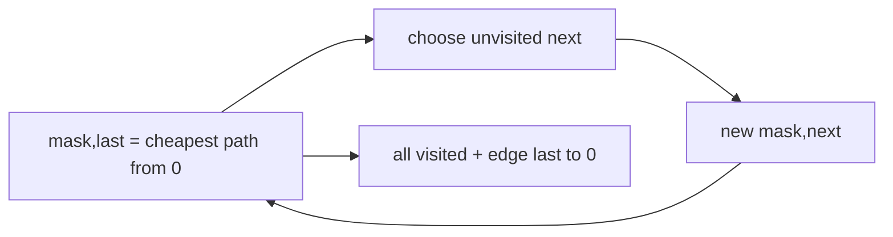

# Traveling Salesperson With Bitmask DP

The input is a complete square matrix of finite nonnegative directed costs. Tours start at vertex
zero, visit every vertex once, and return to zero. Empty and single-vertex matrices return zero;
diagonal entries are ignored.

Held-Karp remembers the visited subset because current position alone is insufficient. It uses
`O(n * 2^n)` space and `O(n^2 * 2^n)` time. This exercise limits `n` to 20: JavaScript bitwise
operators use 32-bit integers, and the exponential table becomes impractical well before that
representation limit. The limit is a deliberate resource-safety contract, not a claim that
20-vertex TSP is cheap.

**Code mapping:** `traveling-salesperson.ts` and `traveling-salesperson.test.ts`.
