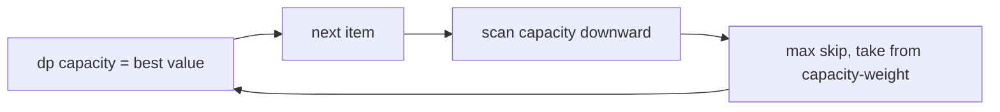

# 0/1 Knapsack

Each item may be selected zero or one time. Weights are positive safe integers, values are finite,
arrays must align, and capacity is a nonnegative safe integer. The empty selection is valid.

Downward updates ensure `dp[c - weight]` still describes the previous item set. Time is `O(nC)` and
space `O(C)`, where `C` is numeric capacity, so the algorithm is pseudo-polynomial rather than
polynomial in the number of bits used to write `C`.

The API returns only the maximum value, not selected indexes; no reconstruction table is required.

**Code mapping:** `zero-one-knapsack.ts` and `zero-one-knapsack.test.ts`.
