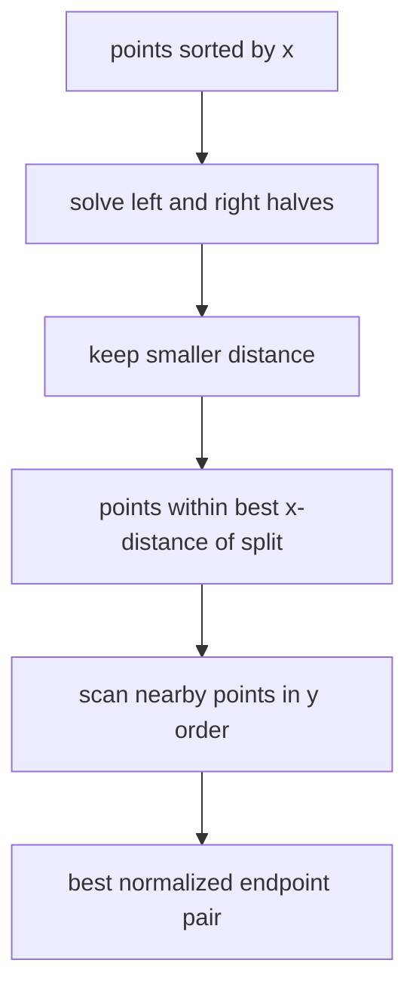

# Closest Pair Of Points

Below two points, `closestPair` returns `undefined`. Duplicate occurrences remain separate
candidates and can produce a zero-distance pair. Returned endpoints are snapshots sorted
lexicographically.

Equal distances choose the lexicographically smallest normalized pair. The divide-and-conquer
algorithm is `O(n log n)` time when y-order is maintained through recursive merges and uses `O(n)`
working space. Re-sorting every recursive strip would instead add an avoidable logarithmic factor.

**Code mapping:** `closest-pair.ts` and `closest-pair.test.ts`.
