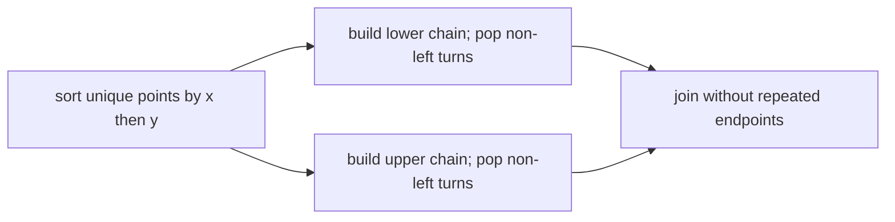

# Convex Hull

The hull is the smallest convex boundary containing all input points. Coordinate duplicates use
SameValueZero equality and are removed; returned points are snapshots.

Andrew's monotone chain returns counterclockwise vertices beginning at the lexicographically
smallest point. Popping on clockwise **or collinear** turns omits points inside a straight hull edge.
All-collinear input returns only its extreme point(s). Sorting costs `O(n log n)` time; chains and
snapshots use `O(n)` space.

**Code mapping:** `convex-hull.ts` and `convex-hull.test.ts`.
