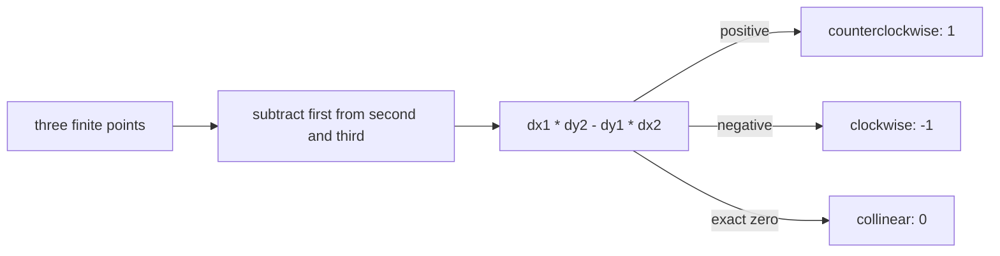

# Orientation

Orientation is the sign of the 2D cross product from `first -> second` to `first -> third`.

The operation is `O(1)` time and space. Exact zero refers to the computed IEEE-754 value, not exact
real arithmetic. The implementation rejects nonfinite coordinates and nonfinite intermediate
results, but it does not repair rounding near zero.

**Code mapping:** `orientation.ts` and `orientation.test.ts`.
