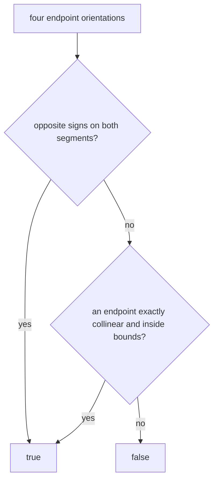

# Closed Segment Intersection

`segmentsIntersect(a,b,c,d)` asks whether closed segments `ab` and `cd` share any point. Proper
crossings, endpoint touches, collinear overlap, and a point lying on another segment all count.

Inclusive min/max coordinate bounds handle collinear points. Zero-length segments need no special
public rule because the same collinear-and-bounds test covers them. Cost is `O(1)` time and space.

**Code mapping:** `segments-intersect.ts` and `segments-intersect.test.ts`.
