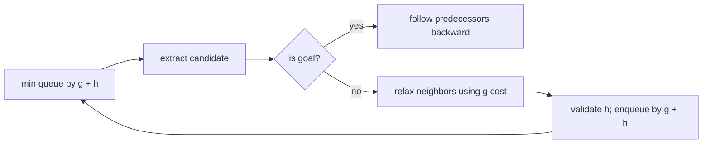

# A* Search

`aStar` finds one path from `start` to `goal` in a graph with nonnegative edge weights. Both
endpoints must exist. It returns `[]` when the goal is unreachable and `[start]` when both endpoints
are the same.

Every evaluated heuristic value must be finite and nonnegative. The library can validate that, but
the caller is responsible for admissibility and consistency if an optimal path is required. A zero
heuristic reduces A* to Dijkstra. Worst-case time and space can reach the explored graph size; heap
operations add a logarithmic factor, while a useful heuristic may explore much less in practice.

**Code mapping:** `a-star.ts` is the shell; `shortest-paths.test.ts` covers optimal zero-heuristic
paths, unreachable/trivial paths, endpoint validation, bad heuristics, and negative edges.
