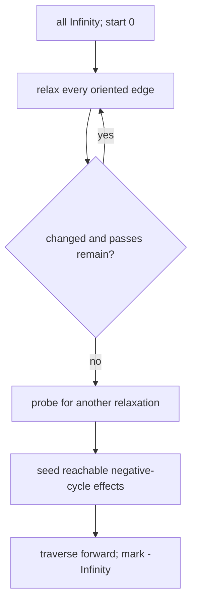

# Bellman-Ford Shortest Paths

Bellman-Ford accepts negative edges and computes one-source shortest paths when they have finite
values. It also reports vertices whose costs can decrease without bound.

An undirected stored edge must be relaxed in both directions. A negative cycle affects the result
only when reachable from `start`; every vertex reachable from that cycle receives `-Infinity`, loses
its predecessor, and appears in `affectedByNegativeCycle`. Other unreachable vertices stay
`Infinity`. Worst-case time is `O(VE)` and extra space is `O(V)` beyond the edge snapshot.

**Code mapping:** `bellman-ford.ts` is the shell; `shortest-paths.test.ts` distinguishes reachable
cycle effects from an unreachable negative cycle.
