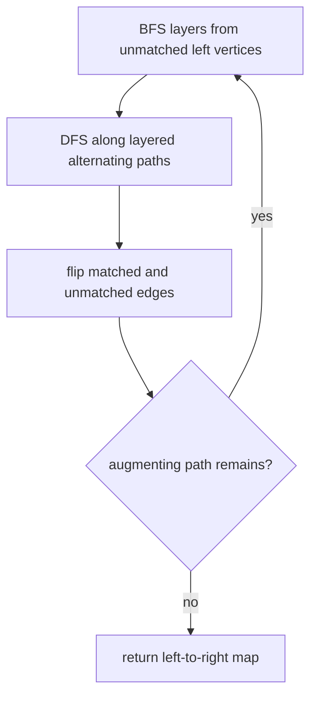

# Maximum Bipartite Matching

`maximumBipartiteMatching(left, right, edges)` returns a map assigning distinct right values to as
many left values as possible. Each partition is snapshotted and deduplicated with SameValueZero
equality. An edge outside the declared partitions throws `RangeError`; duplicate edges are ignored.

Hopcroft-Karp finds several shortest augmenting paths per phase. It targets `O(E sqrt(V))` time and
`O(V + E)` space. Left vertex and edge input order make the selected maximum matching deterministic
when several equally large answers exist.

**Code mapping:** `maximum-bipartite-matching.ts` is the shell; `flow-and-matching.test.ts` verifies
cardinality, unique right assignments, duplicate tolerance, and endpoint validation.
