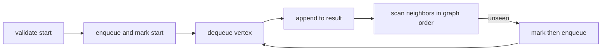

# Breadth-First Traversal

Breadth-first search visits vertices by increasing unweighted edge distance from `start`. The start
must be present; otherwise `breadthFirst` throws `RangeError`.

Mark when enqueuing, not when dequeuing. That prevents two incoming edges from scheduling the same
vertex twice. On an adjacency list, reachable traversal is `O(V + E)` time and `O(V)` extra space.

**Code mapping:** `breadth-first.ts` contains the exercise shell. `traversal.test.ts` verifies
neighbor order and missing-start behavior.
