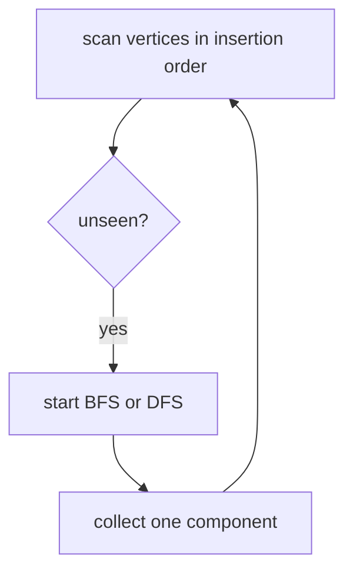

# Connectivity, Cycles, And Bipartite Checking

`connectedComponents` and `isBipartite` accept only undirected graphs. They throw `TypeError` for a
directed graph. `hasCycle` handles either kind.

Components are ordered by their earliest vertex; isolated vertices form one-element components.
The bipartite check starts a two-color traversal in every component. An edge joining equal colors,
including a self-loop, returns false.

Cycle state differs by graph kind: directed DFS detects an edge to the active path, while
undirected DFS ignores the edge back to its parent and treats any other visited neighbor as a
cycle. Each operation is `O(V + E)` time and `O(V)` extra space on an adjacency list.

**Code mapping:** `connected-components.ts`, `has-cycle.ts`, and `is-bipartite.ts` are the shells;
`traversal.test.ts` covers disconnected graphs, both cycle modes, self-loops, and wrong graph kind.
