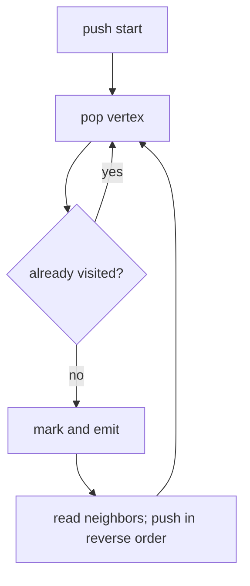

# Depth-First Traversal

Depth-first search follows one branch before returning to alternatives. AlgoHatch specifies
preorder output and requires the start vertex to exist.

Reversing pushes makes the explicit stack visit the first neighbor first, matching recursive DFS
without relying on the JavaScript call stack. On an adjacency list the cost is `O(V + E)` time and
`O(V)` extra space.

**Code mapping:** `depth-first.ts` contains the exercise shell. `traversal.test.ts` fixes the
expected preorder and validates missing starts.
