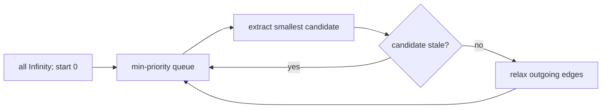

# Dijkstra Shortest Paths

`dijkstra(graph, start)` computes minimum total weight from one start when every edge weight is
nonnegative. A missing start or any negative graph edge throws `RangeError`.

The result includes every graph vertex. Unreachable vertices remain `Infinity`; `previous` contains
only reached non-start vertices; `affectedByNegativeCycle` is empty. With a binary heap and an
adjacency list, time is `O((V + E) log V)`, extra space `O(V + E)` including queue entries.

**Code mapping:** `dijkstra.ts` is the shell; `shortest-paths.test.ts` verifies distances,
predecessors, unreachable vertices, missing starts, and negative-edge rejection.
