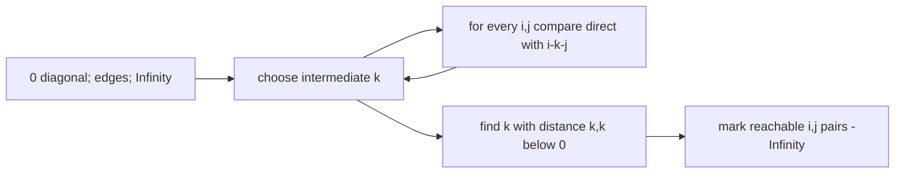

# Floyd-Warshall All-Pairs Shortest Paths

Floyd-Warshall computes a distance for every ordered pair of vertices. It supports negative edges
and exposes negative-cycle effects directly in the distance matrix.

The diagonal begins at zero, including isolated vertices. An unreachable pair is `Infinity`. Pair
`(i, j)` is `-Infinity` when `i` can reach a negative cycle and that cycle can reach `j`. The cost is
`O(V^3)` time and `O(V^2)` space, making this suitable for dense or modest-size graphs rather than
large sparse ones.

**Code mapping:** `floyd-warshall.ts` is the shell; `shortest-paths.test.ts` verifies complete pair
coverage, isolation, and negative-cycle propagation.
