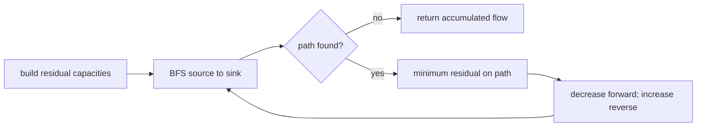

# Maximum Flow

`maximumFlow(vertices, edges, source, sink)` treats each edge's capacity independently from weighted
graph distance. Vertices use SameValueZero identity and must be declared before use. Capacities must
be finite and nonnegative; parallel directed entries add their capacities.

Missing endpoints, source, or sink throw `RangeError`. Equal source and sink returns zero. The target
implementation is Edmonds-Karp: BFS chooses the fewest-edge augmenting path, reverse residual edges
allow earlier choices to be rerouted, and the worst-case cost is `O(VE^2)` time with `O(V + E)`
residual storage.

**Code mapping:** `maximum-flow.ts` is the shell; `flow-and-matching.test.ts` covers residual
rerouting, parallel capacities, source equality, and input validation.
