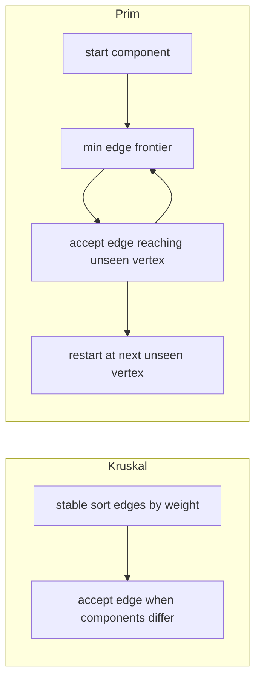

# Minimum Spanning Forests

Kruskal and Prim accept undirected graphs and return a minimum spanning forest. A disconnected graph
therefore receives one minimum tree per nontrivial component; isolated vertices require no edge.
Directed input throws `TypeError`. Self-loops are ignored and negative weights are valid.

Equal weights use graph edge order as the tie-breaker. `prim` optionally accepts the first start
vertex and throws `RangeError` if it is absent; remaining components still follow vertex order.
Kruskal is `O(E log E)` time with `O(V + E)` working space. Heap-based Prim is
`O((V + E) log V)` time and `O(V + E)` working space on an adjacency list.

**Code mapping:** `kruskal.ts` and `prim.ts` are the shells; `spanning.test.ts` covers disconnected
input, negative edges, self-loops, isolated vertices, directedness, and optional start behavior.
