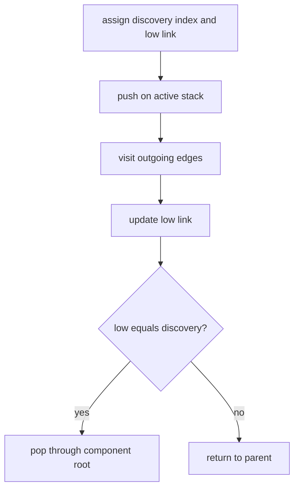

# Strongly Connected Components

A strongly connected component is a maximal group where every vertex can reach every other vertex.
This operation accepts directed graphs only and throws `TypeError` for undirected input.

Tarjan's algorithm uses one traversal, an active stack, discovery indexes, and low links. Completed
groups are reordered by their earliest graph vertex so DFS completion details do not leak into the
public result. Cost is `O(V + E)` time and `O(V)` extra space on an adjacency list.

**Code mapping:** `strongly-connected-components.ts` is the shell; `ordering.test.ts` verifies
mutually reachable groups, isolated vertices, output order, and wrong graph kind.
