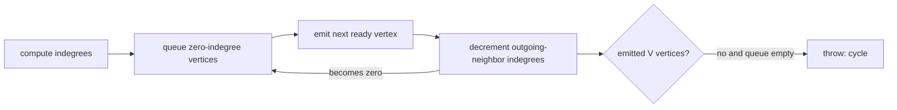

# Topological Sort

A topological order places every directed edge's source before its destination. It exists only for
a directed acyclic graph. Undirected input throws `TypeError`; a directed cycle throws `Error`.

Kahn's algorithm preserves graph insertion order among currently available vertices. It runs in
`O(V + E)` time and uses `O(V)` extra space on an adjacency list.

**Code mapping:** `topological-sort.ts` is the shell; `ordering.test.ts` verifies deterministic
ordering, cycle rejection, and directedness.
