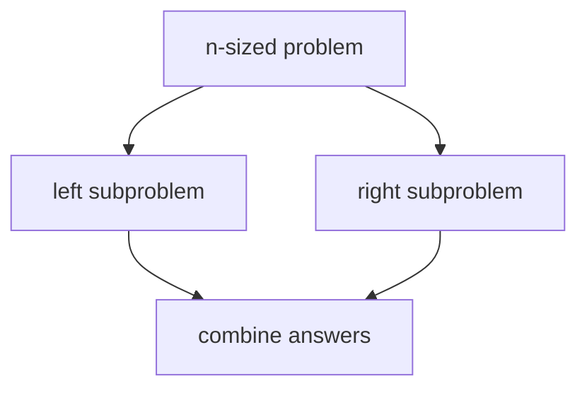

# Divide And Conquer And Recursion Trees

Divide and conquer is a design pattern, not another package API: split an input into smaller
independent subproblems, solve them recursively, and combine their answers.

A recursion tree records work by level. For a recurrence such as `T(n) = 2T(n/2) + O(n)`, each
level performs `O(n)` combine work and there are `O(log n)` levels, yielding `O(n log n)`. The tree
is an analysis tool; it is not runtime state the implementation must construct.

Concrete repository exercises already teach the pattern:

- merge sort divides evenly and combines by merging;
- quicksort divides around a partition and has input-dependent balance;
- binary search keeps only one half, making it decrease-and-conquer;
- enumeration is different: its recursive calls explore a choice tree rather than independent
  halves that are combined.

Refer to the focused searching and sorting pages and tests when activating those implementations.
