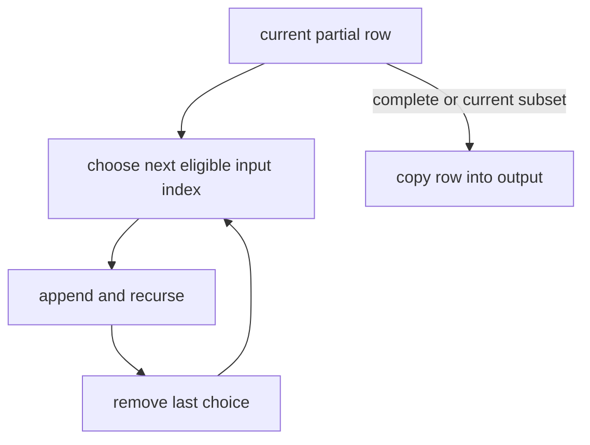

# Backtracking Enumeration

Enumeration builds one candidate incrementally, recurses, then undoes the last choice. AlgoHatch
treats input positions as distinct, so repeated values may produce repeated result rows.

- `permutations` chooses every unused index in order; empty input returns `[[]]`.
- `combinations(values, k)` chooses increasing indexes; `k = 0` returns `[[]]` and invalid `k`
  throws `RangeError`.
- `subsets` emits the current row before extending it, giving a deterministic preorder; empty input
  returns `[[]]`.

Copying outputs is part of the cost: permutations take `O(n * n!)`, combinations
`O(k * C(n,k))`, and subsets `O(n * 2^n)` in the worst case. Result storage has the same
output-sensitive scale, plus `O(n)` recursion state.

**Code mapping:** `permutations.ts`, `combinations.ts`, and `subsets.ts`; verified by
`enumeration.test.ts`.
