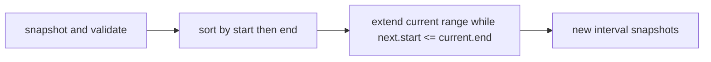
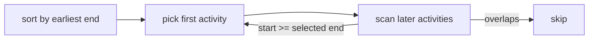

# Intervals And Greedy Selection

These exercises use finite nonempty half-open intervals `[start, end)`. Touching intervals merge for
coverage, but are compatible for scheduling because one finishes exactly when the next starts.

`mergeIntervals` does not mutate or return original interval objects. Sorting dominates the
`O(n log n)` time; the sweep and output use `O(n)` space.

Earliest finish leaves at least as much room as any alternative first choice, which supports the
greedy exchange argument. `activitySelection` returns a maximum-size compatible subset with
deterministic end/start/input-order ties in `O(n log n)` time and `O(n)` snapshot space.

**Code mapping:** `merge-intervals.ts` and `activity-selection.ts`; verified by
`intervals-and-greedy.test.ts`.
