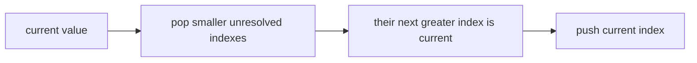
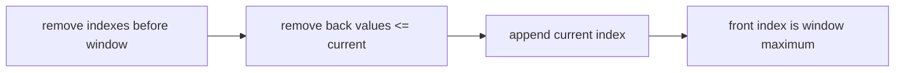

# Monotonic Stacks And Deques

A monotonic structure discards candidates that can no longer answer any future query.

`nextGreaterIndexes` asks for a strictly greater value, so equal values do not resolve each other.
Unresolved positions receive `-1`.

`slidingWindowMaximum` requires finite values and a positive safe window no larger than the input.
Keeping indexes, not only values, makes expiration precise. Every index is pushed and popped at most
once, so both algorithms use `O(n)` time. The stack may use `O(n)` space; the deque uses `O(k)` for
window size `k`.

**Code mapping:** `next-greater-indexes.ts` and `sliding-window-maximum.ts`; verified by
`monotonic.test.ts`.
