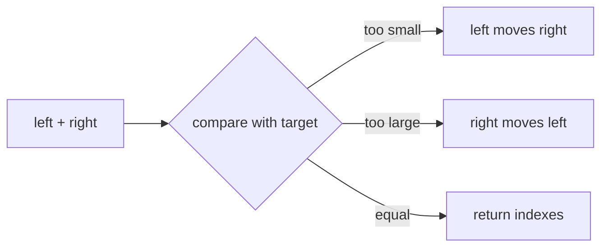
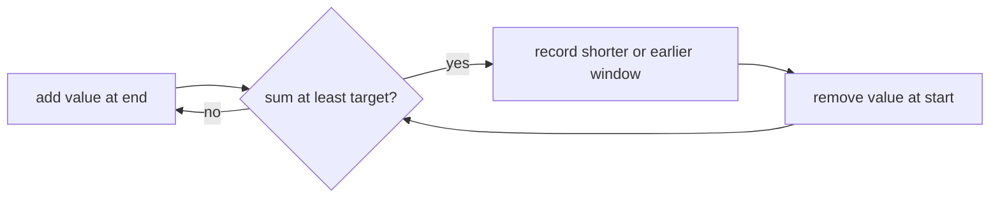

# Two Pointers And Variable Windows

Two pointers are useful when moving either boundary lets the algorithm discard impossible answers.

`twoSumSorted` requires finite nondecreasing input. It returns the first pair encountered by the
standard inward scan, or `undefined`. Validation and scanning are `O(n)` time and `O(1)` extra space.

`minimumWindowAtLeast` requires nonnegative finite values and a positive finite target. That domain
is essential: with negative values, shrinking a window is not monotonic and this technique is not
correct. It returns the shortest half-open window, earliest on ties, in `O(n)` time and `O(1)` space.

**Code mapping:** `two-sum-sorted.ts` and `minimum-window-at-least.ts`; verified by
`pointers-and-windows.test.ts`.
