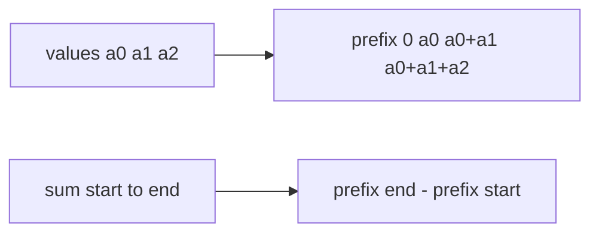
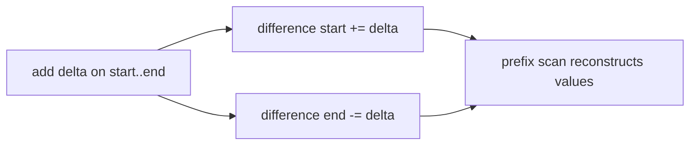

# Prefix Sums And Difference Arrays

Both techniques precompute how boundaries affect a sequence. Prefix sums make later immutable range
queries cheap; a difference array batches many range updates before one reconstruction.

`prefixSums(values)` returns `n + 1` totals with a leading zero. `rangeSum` uses half-open bounds
`[start, endExclusive)` and permits an empty valid range. Its prefix argument is expected to come
from `prefixSums`; it validates bounds and the two addressed totals without scanning all input, so
the query remains `O(1)`.

`applyRangeChanges` validates all changes as finite deltas over valid half-open ranges. Empty ranges
do nothing. Construction costs `O(n)` space; prefix build is `O(n)`, and `c` range changes plus
reconstruction cost `O(n + c)`.

**Code mapping:** `prefix-sums.ts` and `range-changes.ts`; verified by
`prefix-and-ranges.test.ts`.
