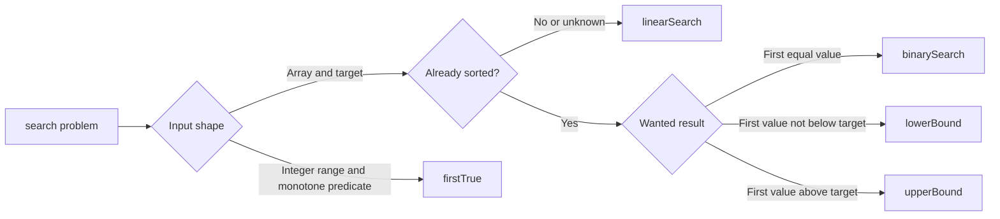
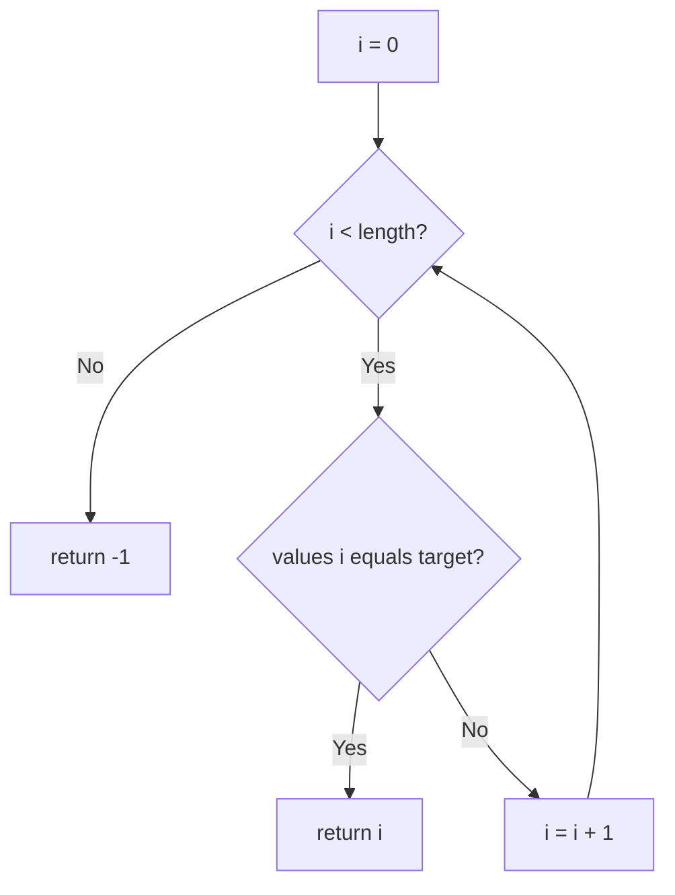
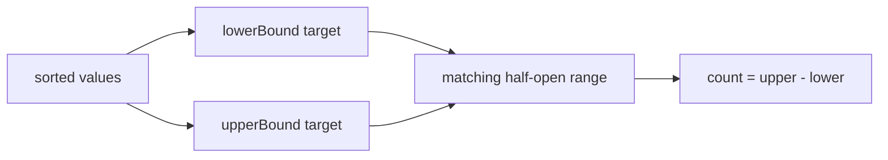
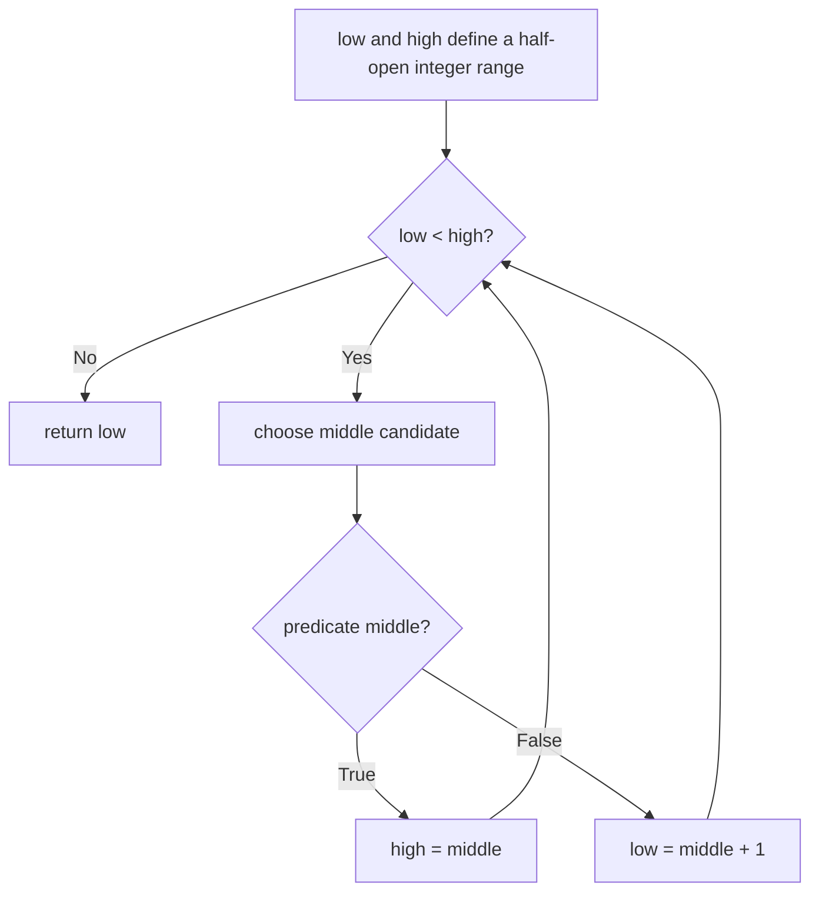

# Searching Algorithms

**Status:** research-audited exercise specification; implementations and tests remain skipped and
are not public.

## What This Topic Provides

Searching answers one of two practical questions:

- Where is the first value that matches a target?
- Where would a target begin or end inside already sorted values?

`linearSearch` works with any readonly array. The other functions gain logarithmic search time by
requiring an array already sorted under the same comparator passed to the function.

## Proposed API

```ts
type Equality<T> = (left: T, right: T) => boolean;
type Comparator<T> = (left: T, right: T) => number;

linearSearch<T>(values: readonly T[], target: T, equals?: Equality<T>): number;
binarySearch<T>(values: readonly T[], target: T, compare: Comparator<T>): number;
lowerBound<T>(values: readonly T[], target: T, compare: Comparator<T>): number;
upperBound<T>(values: readonly T[], target: T, compare: Comparator<T>): number;
firstTrue(
  lowInclusive: number,
  highExclusive: number,
  predicate: (candidate: number) => boolean,
): number;
```

The source-of-truth TypeScript types are in `searching.contract.ts`.

## Shared Behavior

1. None of the functions changes `values`.
2. Empty input is valid.
3. Comparator results are interpreted by sign: negative, zero, or positive.
4. A comparator must be deterministic and must describe one consistent order.
5. Ordered functions assume nondecreasing input under that comparator.
6. Ordered functions do not check whether the input is sorted. A full check would cost `O(n)` and
   defeat their `O(log n)` purpose.



## Equality And Ordering

`linearSearch` uses SameValueZero when `equals` is omitted. In practical terms:

- `NaN` matches `NaN`.
- `0` and `-0` match.
- Objects match only when they are the same object.

Pass `equals` when domain values need another meaning of equality, such as matching records by
identifier.

Ordered searches use `compare(left, right)`:

| Result | Meaning |
|---|---|
| `< 0` | `left` comes before `right` |
| `0` | equal for this ordering |
| `> 0` | `left` comes after `right` |

The numeric magnitude does not matter. Returning `-100` means the same thing as returning `-1`.

## Linear Search

`linearSearch` checks indexes from left to right. It returns the first matching index or `-1` when
there is no match.



For `["a", "b", "a"]`, searching for `"a"` returns `0`, not `2`.

## Binary Search

`binarySearch` returns the first comparator-equal index, or `-1` when absent. Choosing the first
match makes duplicates deterministic.

Use a half-open interval `[low, high)`. At every step, everything before `low` is known to come
before the target, while everything at or after `high` cannot be the first match.

```mermaid
flowchart TD
  Start[low = 0; high = length] --> Loop{low < high?}
  Loop -->|No| Verify{low is in range and equal?}
  Verify -->|Yes| Found[return low]
  Verify -->|No| Missing[return -1]
  Loop -->|Yes| Mid[mid = low + floor((high - low) / 2)]
  Mid --> Compare{values mid before target?}
  Compare -->|Yes| Right[low = mid + 1]
  Compare -->|No| Left[high = mid]
  Right --> Loop
  Left --> Loop
```

Example: in `[1, 2, 2, 2, 4]`, searching for `2` returns `1`.

## Lower And Upper Bound

Bounds describe insertion positions, so unlike `binarySearch` they return a value from `0` through
`values.length` and never return `-1`.

```text
values:       [1, 2, 2, 2, 4]
indexes:       0  1  2  3  4
lowerBound(2):    ^              first value >= 2
upperBound(2):             ^     first value > 2
result:          1         4
```

This also gives the matching range `[lowerBound, upperBound)`. Its length is the number of values
equal to the target under the comparator.



For a target smaller than every value, both bounds may be `0`. For a target greater than every
value, both may equal `values.length`.

## Binary Search On An Answer

Some problems do not provide a sorted array. Instead, they provide an integer range and a yes/no
question that changes only once from false to true. `firstTrue` finds that change point.

```text
candidate:  0  1  2  3  4  5  6  7
predicate:  F  F  F  F  F  T  T  T
result:                    5
```

The interval is `[lowInclusive, highExclusive)`. Both bounds must be safe integers and the lower
bound must not exceed the upper bound; invalid bounds throw `RangeError`. If no candidate succeeds,
the function returns `highExclusive`, matching the insertion-boundary convention.



The caller must supply a monotone predicate: once it returns true, it must remain true for every
larger candidate in the interval. The function does not verify this because checking every
candidate would discard the logarithmic benefit.

## Expected Complexity

Let `n` be `values.length`.

| Function | Best time | Worst time | Extra space |
|---|---:|---:|---:|
| `linearSearch` | `O(1)` | `O(n)` | `O(1)` |
| `binarySearch` | `O(log n)` | `O(log n)` | `O(1)` |
| `lowerBound` | `O(log n)` | `O(log n)` | `O(1)` |
| `upperBound` | `O(log n)` | `O(log n)` | `O(1)` |
| `firstTrue` | `O(log r)` | `O(log r)` | `O(1)` |

The ordered functions still take logarithmic time when the match happens to be near the middle
because finding the first matching boundary may require more interval reductions. For `firstTrue`,
`r` is the number of integer candidates in the range and predicate evaluation is assumed `O(1)`.

## Implementation Guide

1. Implement `linearSearch`, including the default SameValueZero comparison.
2. Implement `lowerBound` with a half-open interval.
3. Build `binarySearch` from the same boundary logic, then verify that the candidate is equal.
4. Implement `upperBound` by moving right when the middle value is equal to the target.
5. Implement `firstTrue` using the same boundary reasoning, after validating its integer range.
6. Use `low + Math.floor((high - low) / 2)` so the interval calculation is explicit.
7. Do not call native `indexOf`, `findIndex`, or another binary-search library in these exercises.

## Traceability

| Concern | Source | Verification |
|---|---|---|
| Function signatures | `searching.contract.ts` | TypeScript check |
| Linear behavior and equality | `linear-search.ts` | `searching.test.ts` |
| First duplicate match | `binary-search.ts` | `searching.test.ts` |
| Insertion boundaries | `lower-bound.ts`, `upper-bound.ts` | `searching.test.ts` |
| Monotone integer boundary | `first-true.ts` | `searching.test.ts` |
| Input preservation | all four source files | `searching.test.ts` |

The tests remain skipped until the owner begins this implementation exercise.
