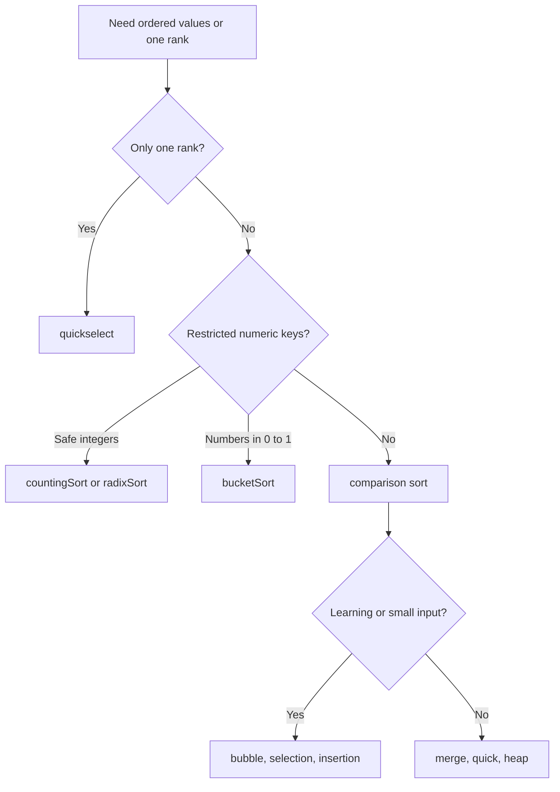
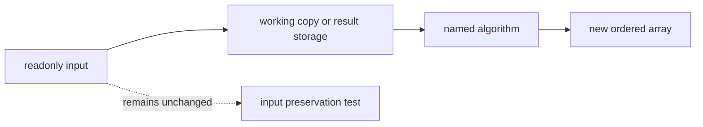
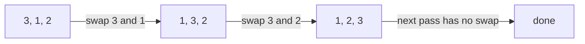
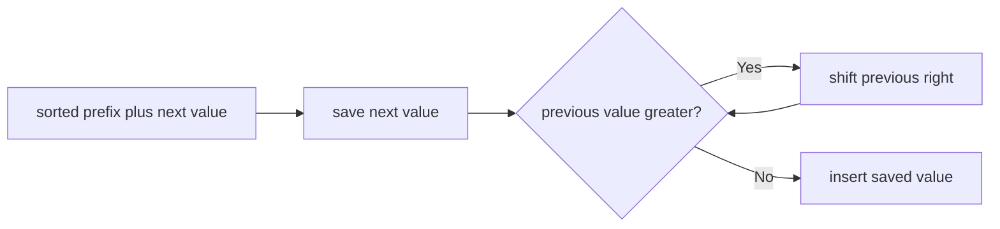
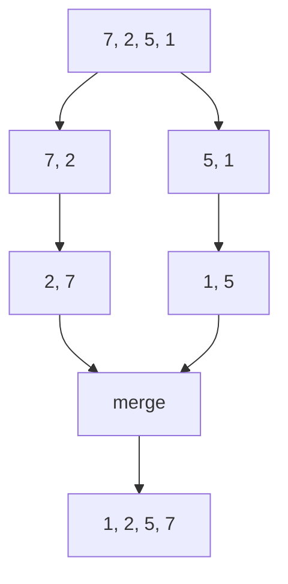
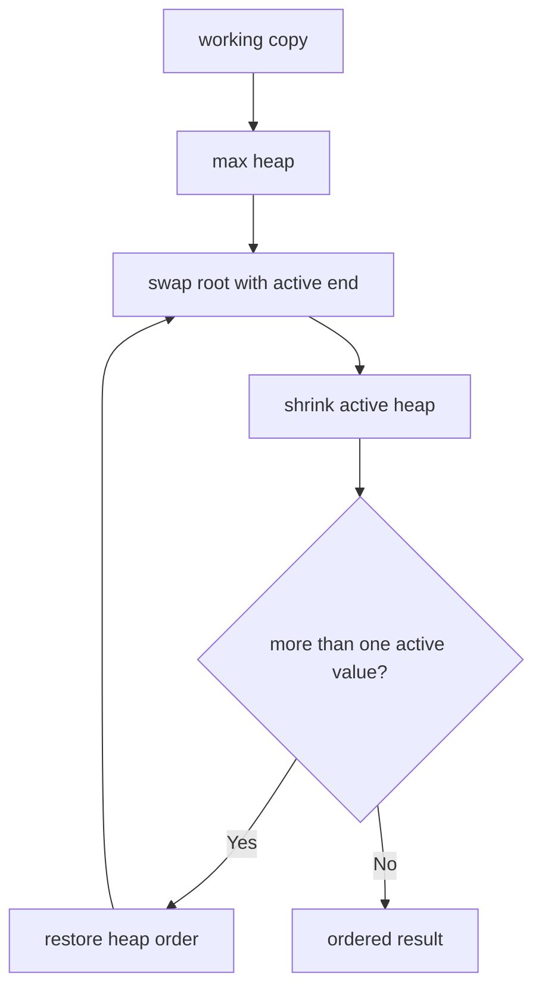
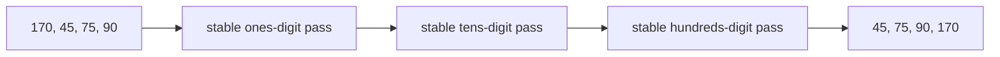
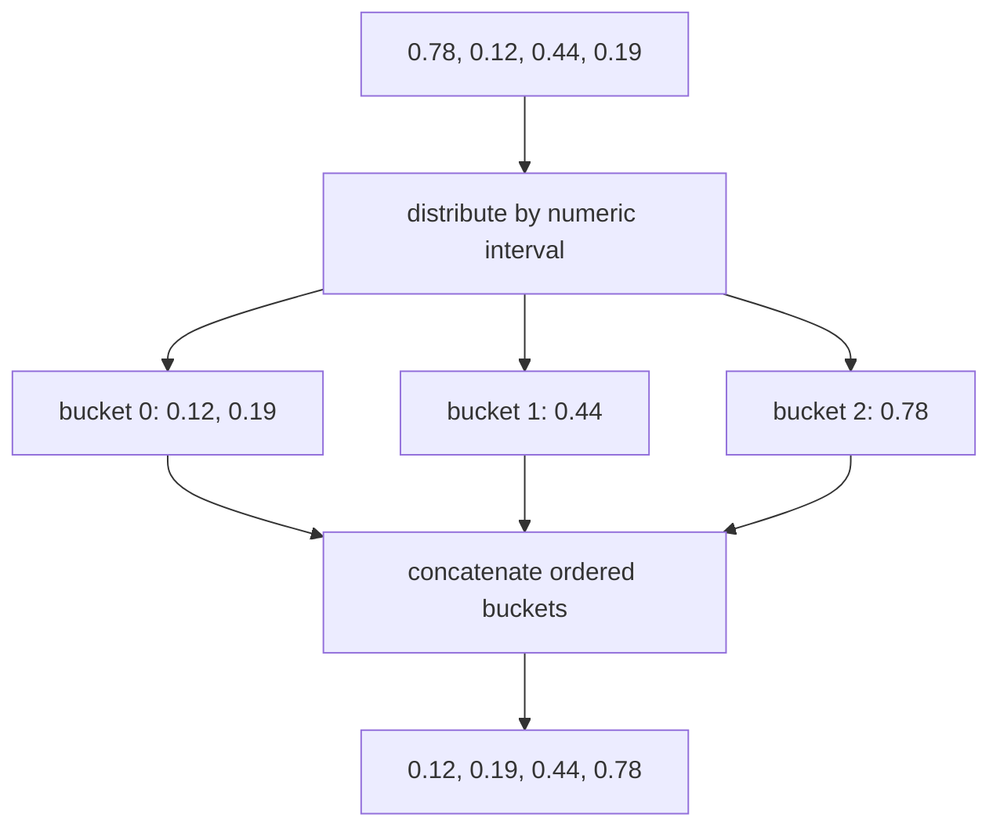
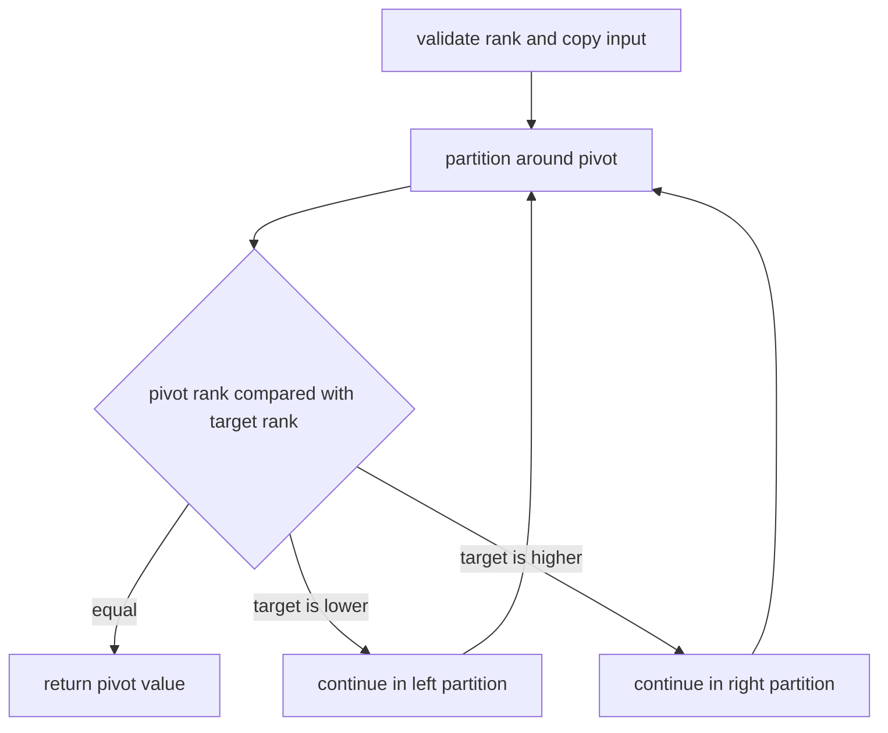

# Sorting And Selection

**Status:** research-audited exercise specification; implementations and tests remain skipped and
are not public.

## What This Topic Provides

Sorting returns the same values in comparator order. Selection finds the value at one sorted rank
without requiring every value to be fully ordered.

This topic deliberately includes several algorithms that solve the same problem differently.
Their value is in understanding when input order, key range, memory, stability, or worst-case
guarantees change the engineering choice.



## Proposed API

```ts
type Comparator<T> = (left: T, right: T) => number;
type ComparisonSort = <T>(values: readonly T[], compare: Comparator<T>) => T[];
type SafeIntegerSort = (values: readonly number[]) => number[];
type UnitIntervalSort = (values: readonly number[]) => number[];
type Quickselect = <T>(values: readonly T[], index: number, compare: Comparator<T>) => T;
```

The source-of-truth TypeScript types are in `sorting.contract.ts`.

## Shared Sorting Contract

1. Every sort returns a new array.
2. No sort changes the caller's input array.
3. The result contains exactly the input values, including duplicates.
4. Empty and one-value arrays are valid.
5. Comparison sorts interpret comparator results only by sign.
6. A comparator must be deterministic and describe one consistent order.
7. Comparison-sort implementations must implement their named algorithm rather than delegate to
   native `sort` or `toSorted`.



### Stability

A stable sort preserves the original relative order of values that compare equal. This matters
when sorting records by one field.

```text
input by score:   A:2, B:1, C:2
stable result:    B:1, A:2, C:2
unstable allowed: B:1, C:2, A:2
```

| Algorithm | Stability promised? |
|---|---|
| Bubble sort | Yes |
| Selection sort | No |
| Insertion sort | Yes |
| Merge sort | Yes |
| Quick sort | No |
| Heap sort | No |
| Counting/radix/bucket sort | Numeric values have no observable identity; radix passes must be stable internally |

## Elementary Comparison Sorts

### Bubble Sort

Bubble sort repeatedly compares neighbors and swaps them only when the left value comes after the
right value. Each completed pass places the largest unsorted value at the end. A pass with no swap
means the result is already sorted.



Equal values must not be swapped; that rule provides stability.

### Selection Sort

Selection sort finds the smallest value in the unsorted suffix and swaps it into the next result
position. It performs quadratic comparisons even when input is already sorted, but performs only
`O(n)` swaps.

```text
[3, 1, 2]  choose 1 -> [1 | 3, 2]
[1, 3, 2]  choose 2 -> [1, 2 | 3]
```

The long-distance swap can move equal records across each other, so stability is not promised.

### Insertion Sort

Insertion sort grows a sorted prefix. For each next value, shift larger prefix values right and
insert the value into the gap.



Stop shifting when values compare equal so their original order remains stable. Insertion sort is
especially useful for small or nearly sorted inputs.

## Efficient Comparison Sorts

### Merge Sort

Merge sort divides the array, sorts both halves, and merges the ordered halves. During merge, take
from the left half when values compare equal to preserve stability.



The guaranteed `O(n log n)` time comes with `O(n)` merge storage.

### Quick Sort

Quick sort partitions a working copy around a pivot, then recursively sorts values below and above
the pivot partition.

```mermaid
flowchart LR
  Input[7, 2, 5, 1; pivot 5] --> Partition[2, 1 | 5 | 7]
  Partition --> Left[sort left partition]
  Partition --> Right[sort right partition]
  Left --> Result[1, 2, 5, 7]
  Right --> Result
```

Balanced partitions give `O(n log n)` time. Repeatedly choosing an extreme pivot produces the
`O(n^2)` worst case. Equal-key handling must always make progress. Stability is not promised.

### Heap Sort

Heap sort first arranges the working copy as a max heap. It then swaps the maximum root with the
last value in the active heap, shrinks the heap, and restores heap order by moving the new root
downward.



Heap sort guarantees `O(n log n)` time and needs `O(1)` working space after the public API's result
copy. Its swaps do not preserve equal-value order.

## Distribution Sorts

Distribution sorts avoid general pairwise comparisons by using restrictions on numeric keys.

### Counting Sort

`countingSort` accepts only safe integers, including negatives. It counts each value relative to
the minimum, then emits values in key order.

```text
input:   [3, -1, 3, 0]
range:   -1, 0, 1, 2, 3
counts:   1, 1, 0, 0, 2
result:  [-1, 0, 3, 3]
```

Let `r = maximum - minimum + 1`. Time and working space are `O(n + r)`, so counting sort is a poor
choice when a few values span a huge range. A non-safe-integer input throws `RangeError`.

### Radix Sort

`radixSort` accepts only safe integers, including negatives. It performs stable passes from the
least significant digit toward the most significant digit. Negative and nonnegative values must
be handled without losing numeric order.



With base `b` and `d` processed digits, time is `O(d(n + b))` and working space is `O(n + b)`.
Pass stability is essential: a later digit must not destroy ordering established by earlier ones.
A non-safe-integer input throws `RangeError`.

### Bucket Sort

`bucketSort` accepts finite numbers in `[0, 1)`. It maps values to buckets, sorts each bucket, and
concatenates buckets from low to high.



With reasonably even distribution, expected work can approach `O(n)`. If every value lands in one
bucket and that bucket uses insertion sort, the worst case is `O(n^2)`. `NaN`, infinities, and
values outside `[0, 1)` throw `RangeError`.

## Quickselect

`quickselect(values, index, compare)` returns the value that would occupy zero-based `index` in a
fully sorted result. It leaves `values` unchanged and does not promise to order the other values.



A non-integer rank or a rank outside `[0, values.length)` throws `RangeError`. Average time is
`O(n)` because only one partition continues; worst-case time is `O(n^2)` after repeatedly poor
pivots. The required result is one value, while the non-mutating contract requires an `O(n)` copy.

## Complexity Comparison

`Result space` is the new output array required by the public contract. `Working space` excludes
that result copy so internally in-place methods remain distinguishable.

| Algorithm | Best time | Average time | Worst time | Working space | Result space |
|---|---:|---:|---:|---:|---:|
| Bubble | `O(n)` | `O(n^2)` | `O(n^2)` | `O(1)` | `O(n)` |
| Selection | `O(n^2)` | `O(n^2)` | `O(n^2)` | `O(1)` | `O(n)` |
| Insertion | `O(n)` | `O(n^2)` | `O(n^2)` | `O(1)` | `O(n)` |
| Merge | `O(n log n)` | `O(n log n)` | `O(n log n)` | `O(n)` | `O(n)` |
| Quick | `O(n log n)` | `O(n log n)` | `O(n^2)` | `O(log n)` average stack, `O(n)` worst | `O(n)` |
| Heap | `O(n log n)` | `O(n log n)` | `O(n log n)` | `O(1)` | `O(n)` |
| Counting | `O(n + r)` | `O(n + r)` | `O(n + r)` | `O(r)` | `O(n)` |
| Radix | `O(d(n + b))` | `O(d(n + b))` | `O(d(n + b))` | `O(n + b)` | `O(n)` |
| Bucket | `O(n)` | `O(n)` under even distribution | `O(n^2)` | `O(n)` | `O(n)` |
| Quickselect | `O(n)` | `O(n)` | `O(n^2)` | depends on iteration/recursion | one value plus `O(n)` input copy |

The symbols are: `n` values, integer range `r`, radix base `b`, and processed digit count `d`.

## Implementation Order

1. Implement the three elementary sorts and make their stability tests pass.
2. Implement merge sort and verify left-first handling of equal values.
3. Implement partitioning once, then use the learned mechanics for quick sort and quickselect.
4. Implement heap sort after the binary-heap topic or alongside it with a private array helper.
5. Implement counting sort before radix sort because stable counting by one digit is useful inside
   radix sort.
6. Implement bucket sort last and keep its `[0, 1)` validation visible.
7. Do not optimize cutoffs, pivot strategies, or bucket counts until the basic named algorithm is
   correct and its tests pass.

## Traceability

| Concern | Source | Verification |
|---|---|---|
| Family signatures | `sorting.contract.ts` | TypeScript check |
| Comparison-sort behavior | six named comparison-sort files | `sorting.test.ts` |
| Promised stability | bubble, insertion, and merge source files | record-order tests |
| Safe-integer domains | `counting-sort.ts`, `radix-sort.ts` | invalid-domain tests |
| Unit-interval domain | `bucket-sort.ts` | boundary and invalid-domain tests |
| Rank and input preservation | `quickselect.ts` | rank/error/non-mutation tests |

The tests remain skipped until the owner begins these implementation exercises.
