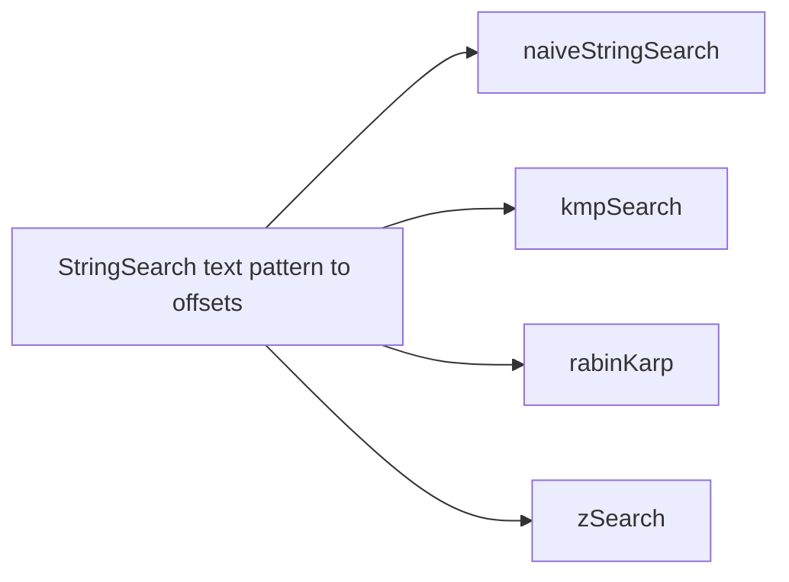

# String Search And Indexing

**Status:** research-audited exercise specifications; implementations and tests remain skipped and
are not public.

## Practical Contract

The single-pattern search functions return every starting offset where `pattern` occurs in `text`,
in increasing order. Matches may overlap. An empty pattern matches every boundary from `0` through
`text.length`; a nonempty pattern longer than the text has no match.

## String And Index Model

Offsets and table lengths use JavaScript UTF-16 code units. This is the same unit used by String
`length`, indexing, `slice`, and native search positions. For example, each emoji outside the basic
multilingual plane usually occupies two positions. Inputs are exact strings: no normalization,
case folding, locale handling, or grapheme segmentation occurs automatically.

This policy differs deliberately from the trie exercises. Trie edges use code points because they
represent text transitions; search functions return code-unit offsets because consumers need
positions compatible with JavaScript string APIs.

## Choosing A Tool

| Tool | Preparation | Search target | Best fit |
|---|---:|---:|---|
| Naive search | none | worst `O(nm)` | baseline, short inputs |
| KMP | `O(m)` | worst `O(n)` | guaranteed linear single-pattern search |
| Rabin-Karp | `O(m)` | expected `O(n + r)`, worst `O(nm)` | rolling windows and hash filtering |
| Z search | `O(n + m)` combined table | worst `O(n + m)` | learning prefix matches at every offset |
| Aho-Corasick | `O(p)` patterns | expected `O(n + r)` | many patterns searched together |
| Suffix array | `O(n log^2 n)` proposed build | `O(m log n + r log r)` | compact repeated searches over fixed text |
| Suffix tree | `O(n)` target build | `O(m + r)` | advanced substring index and construction study |

Here `n` is text length, `m` is pattern length, `p` is total pattern length, and `r` is reported
matches. All lengths are code units. Output arrays require `O(r)` result space.

## Shared Correctness Rules

1. Every returned offset starts an exact code-unit match.
2. Results are increasing and contain overlapping matches.
3. Empty-pattern behavior is consistent across matchers and indexes.
4. Inputs are never mutated and returned arrays do not expose internal index storage.
5. Hash equality is only a filter; exact comparison decides a Rabin-Karp match.
6. Internal sentinels for Z search and suffix trees cannot collide with a caller string.

## Topic Pages

- [Naive String Search](./naive-string-search.md)
- [Prefix Function](./prefix-function.md)
- [KMP Search](./kmp-search.md)
- [Rabin-Karp](./rabin-karp.md)
- [Z Function](./z-function.md)
- [Z Search](./z-search.md)
- [Aho-Corasick](./aho-corasick.md)
- [Suffix Array](./suffix-array.md)
- [Suffix Tree](./suffix-tree.md)

## Learning Order

Implement naive search first, then the prefix function and KMP. Continue with rolling hashes, the Z
function and Z search, then multi-pattern Aho-Corasick. Finish with suffix arrays before attempting
the substantially harder suffix-tree construction.

## Traceability

| Concern | Source | Verification |
|---|---|---|
| Shared function types | `string.contract.ts` | TypeScript check |
| Single-pattern behavior | four search functions | parameterized matcher tests |
| Table definitions | prefix and Z functions | focused table tests |
| Multi-pattern behavior | `AhoCorasick` | overlap, deduplication, and empty-pattern tests |
| Fixed-text indexes | `SuffixArray`, `SuffixTree` | construction and occurrence tests |

The suites remain skipped until the owner activates each exercise.
