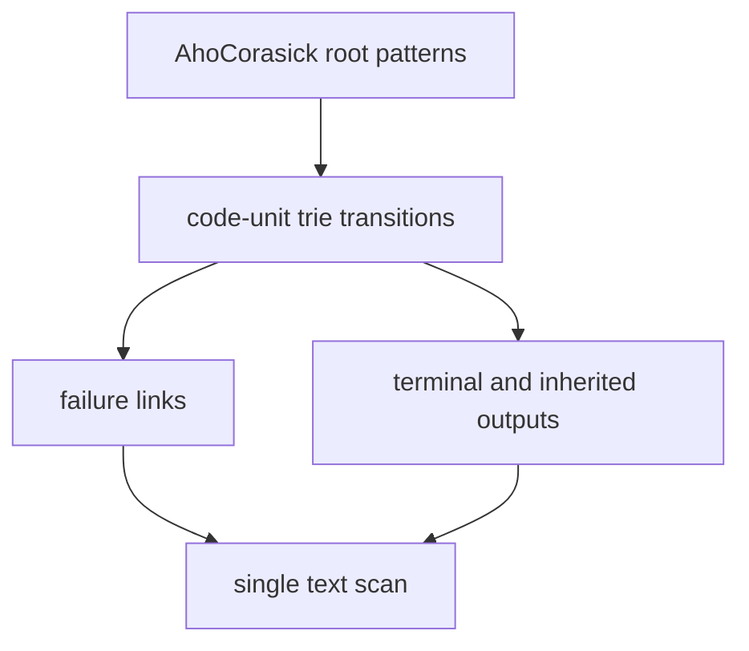
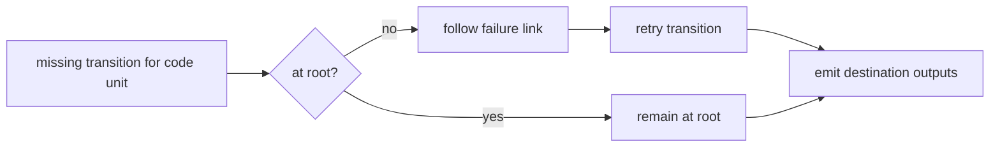

# Aho-Corasick

`new AhoCorasick(patterns)` preprocesses many exact patterns into one automaton.
`search(text)` returns a map containing every unique input pattern in first-occurrence order, with
its increasing match offsets. Duplicate patterns are deduplicated; patterns with no match map to an
empty array.

## Construction

Insert each pattern into a code-unit trie. Then traverse nodes breadth first. A node's failure link
targets the longest proper suffix of its represented prefix that is also a trie prefix. Its output
list includes patterns ending at the node and outputs inherited through that failure link.

The constructor must snapshot the pattern array. The empty pattern is represented at the root and
matches every boundary, handled explicitly if that keeps the automaton simpler.

With map-backed transitions, construction targets expected `O(p)` time and space for total pattern
length `p`. Search targets expected `O(n + r)` time for text length `n` and reported matches `r`.

Implementation lives in `aho-corasick.ts`; `string.test.ts` covers suffix outputs, overlaps,
duplicates, absent patterns, empty patterns, constructor snapshots, and UTF-16 offsets.
