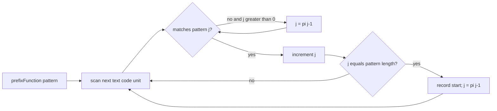

# KMP Search

`kmpSearch(text, pattern)` uses the pattern's prefix-function table to reuse a matched prefix after
a mismatch.

Resetting `j` to the previous border after a complete match is what retains overlapping matches.
The empty pattern is handled directly using the shared contract.

Preprocessing costs `O(m)` time and space; scanning costs `O(n)` time. Total time is `O(n + m)` and
auxiliary space is `O(m)` beyond results. Implementation lives in `kmp-search.ts`; it must use the
same table semantics as `prefix-function.ts` and pass the shared matcher tests.
