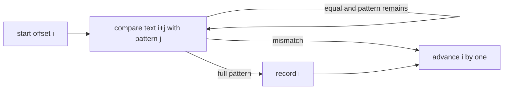

# Naive String Search

`naiveStringSearch(text, pattern)` is the correctness baseline. It tests every viable start offset
and compares the pattern from left to right.

Trying the next offset after a match, rather than jumping by pattern length, preserves overlaps.
Handle the empty pattern before the ordinary loop by returning every boundary.

For text length `n` and pattern length `m`, worst-case time is `O((n-m+1)m)`, commonly written
`O(nm)`. Auxiliary working space is `O(1)` beyond the result array. Empty or longer-pattern cases
can return in `O(n)` result work or `O(1)` respectively.

Implementation lives in `naive-string-search.ts`; shared matcher cases live in `string.test.ts`.
Use this function as a behavioral oracle while implementing optimized matchers.
