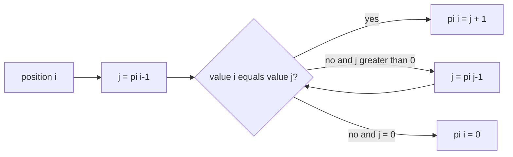

# Prefix Function

`prefixFunction(value)` returns an array `pi` where `pi[i]` is the length of the longest proper
prefix of `value[0..i]` that is also its suffix. Values and lengths use UTF-16 code units.

## Correctness Rules

- The result length equals `value.length`; an empty input returns `[]`.
- `pi[0]` is zero when the string is nonempty.
- `0 <= pi[i] <= i` because the border is proper.
- Each fallback examines the next shorter known border rather than restarting from scratch.

The linear algorithm takes `O(n)` time and `O(n)` result space. Implementation lives in
`prefix-function.ts`; focused examples and UTF-16 length behavior live in `string.test.ts`.
