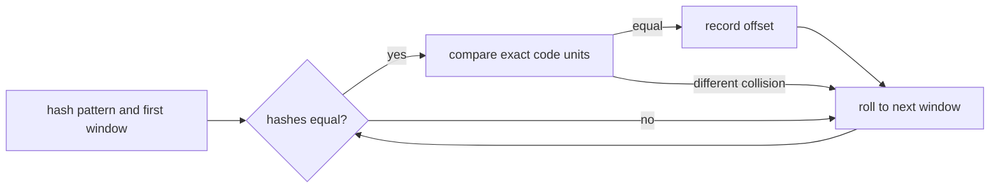

# Rabin-Karp Search

`rabinKarp(text, pattern)` compares a pattern hash with a rolling hash for each equal-length text
window. A matching hash only identifies a candidate; exact code-unit comparison decides whether to
report it.

## JavaScript Arithmetic

JavaScript numbers do not provide exact arbitrary-width integer multiplication. Keep hash
arithmetic in an explicitly bounded representation, such as unsigned 32-bit operations, and use a
consistent update rule for adding and removing code units. Correctness must never depend on the
absence of collisions.

With a useful hash and few false candidates, preprocessing is `O(m)` and scanning is expected
`O(n + r)`. Adversarial collisions can force `O(nm)` exact-verification work. Auxiliary space is
`O(1)` beyond results.

Implementation lives in `rabin-karp.ts`; shared matcher tests verify results, separator-like input,
overlaps, and UTF-16 offsets.
