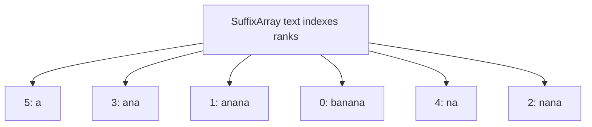
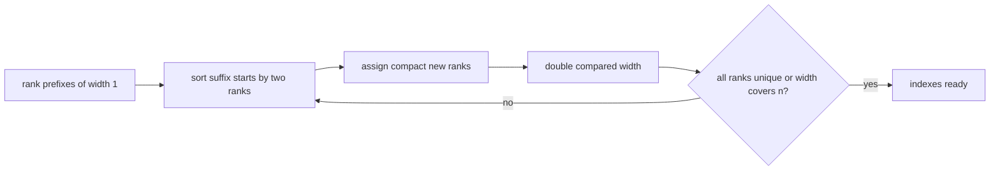

# Suffix Array

`new SuffixArray(text)` stores the starting offset of every nonempty suffix, ordered by UTF-16
lexicographic suffix order. The empty suffix at `text.length` is excluded from `indexes`.

The `indexes` getter returns an independent snapshot. `search(pattern)` uses two binary searches to
find the contiguous suffix range beginning with the pattern, then returns those offsets in numeric
order. Empty-pattern search returns all `text.length + 1` boundaries even though the empty suffix
is not stored in `indexes`.

## Prefix-Doubling Construction

Start by ranking suffixes from their first code unit. On rounds of width `1, 2, 4, ...`, sort each
suffix by the pair `(rank[i], rank[i + width])`, assign new equivalence ranks, and stop when ranks
are unique or width covers the text.

The proposed comparison-sort version takes `O(n log^2 n)` time and `O(n)` working storage.
Searching takes `O(m log n)` comparisons plus `O(r log r)` to return numeric offset order and
`O(r)` result space. More advanced rank-sorting constructions can improve build time later without
changing the contract.

Implementation lives in `suffix-array.ts`; `string.test.ts` verifies suffix order, occurrences,
empty patterns, empty text, and snapshot isolation.
