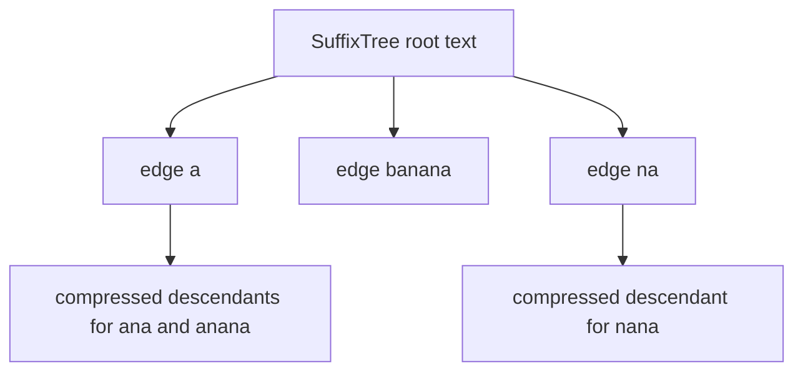
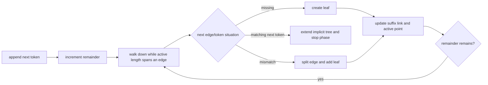

# Suffix Tree

`new SuffixTree(text)` builds a compressed trie of every suffix. `has(pattern)` tests substring
membership, while `occurrences(pattern)` returns all starting offsets in numeric order.

The implementation must use a unique internal terminal token, not a guessed String character.
Edge labels should be represented as spans into the retained token sequence rather than copied
substrings. Leaves identify suffix start offsets.

## Ukkonen State

The exercise targets online construction with an active node, active edge, active length,
remaining suffix count, suffix links, and a shared current leaf end. Each phase adds one token and
resolves all unfinished suffix extensions.

## Correctness Rules

- Each suffix has one root-to-leaf path ending at the unique terminal token.
- Sibling edges begin with different tokens.
- Internal non-root nodes have at least two children after construction.
- Edge spans are nonempty and remain within the retained token sequence.
- Suffix links connect the intended proper-suffix states used by construction.
- Queries never expose or accept the internal terminal token.

The construction target is `O(n)` time and `O(n)` storage under the indexed-token model; a query of
length `m` reporting `r` matches targets `O(m + r)`. Returned numeric sorting may add
`O(r log r)` unless leaf ordering provides it directly.

This is an advanced elective after tries and suffix arrays. Implementation lives in
`suffix-tree.ts`; `string.test.ts` defines public substring, overlap, empty-pattern, empty-text, and
UTF-16 behavior. Add focused construction tests for splits, suffix links, repeated text, and unique
terminal handling while implementing it.
