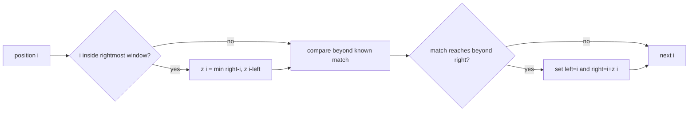

# Z Function

`zFunction(value)` returns an array where `z[i]` is the length of the longest prefix of `value`
that also starts at code-unit offset `i`. AlgoHatch defines `z[0]` as zero.

Use a half-open window `[left, right)` for the rightmost prefix match. Reused table values never
claim knowledge beyond `right`; direct comparisons extend the window only into previously unknown
positions.

The result length equals `value.length`; empty input returns `[]`. The optimized algorithm takes
`O(n)` time and `O(n)` result space. Implementation lives in `z-function.ts`; focused examples are
in `string.test.ts`.
