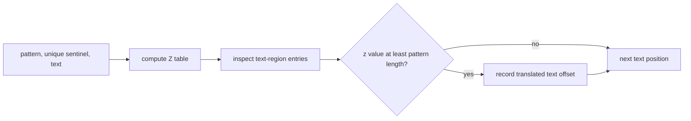

# Z Search

`zSearch(text, pattern)` computes prefix matches over a logical sequence containing the pattern, a
unique sentinel, and the text. A text position is a match when its Z value reaches pattern length.

No JavaScript string character is guaranteed absent from arbitrary input. Use an internal token
sequence containing a fresh `Symbol` sentinel, or an equivalent representation that cannot collide,
instead of guessing a separator such as `$` or `\0`.

Empty patterns follow the shared direct rule. Nonempty search takes `O(n + m)` time and `O(n + m)`
working/result-table space. Implementation lives in `z-search.ts`; shared tests include ordinary
separator-like characters to catch unsafe sentinel choices.
